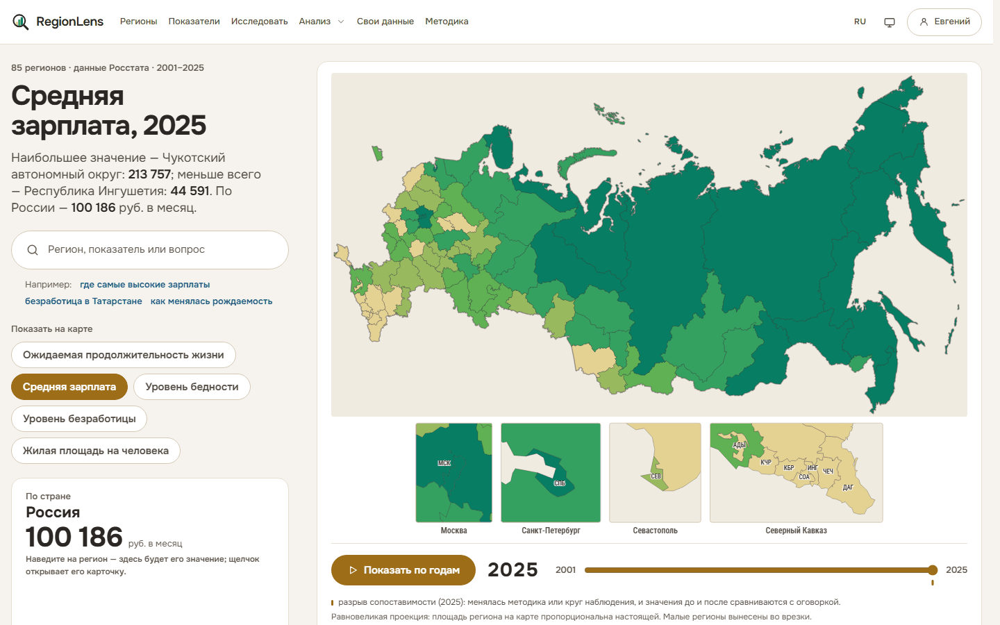
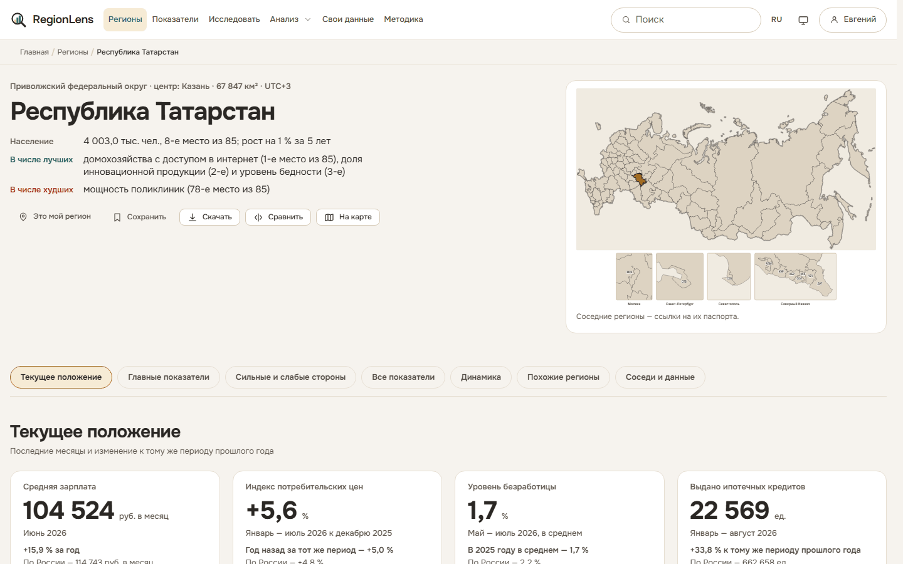
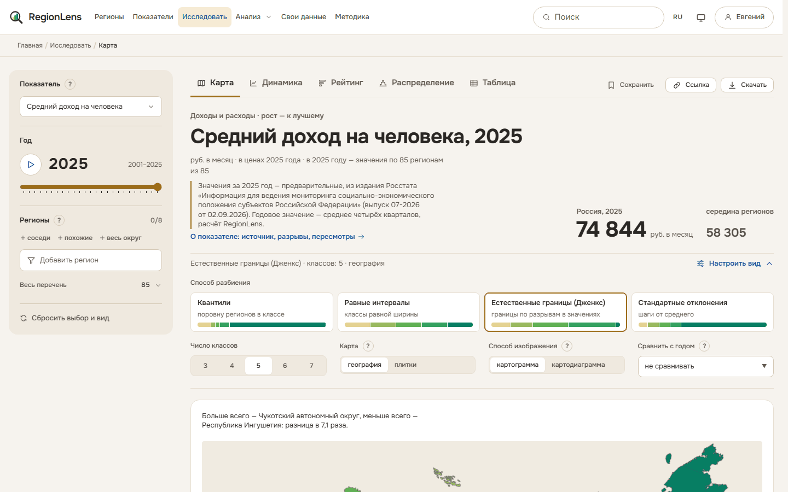
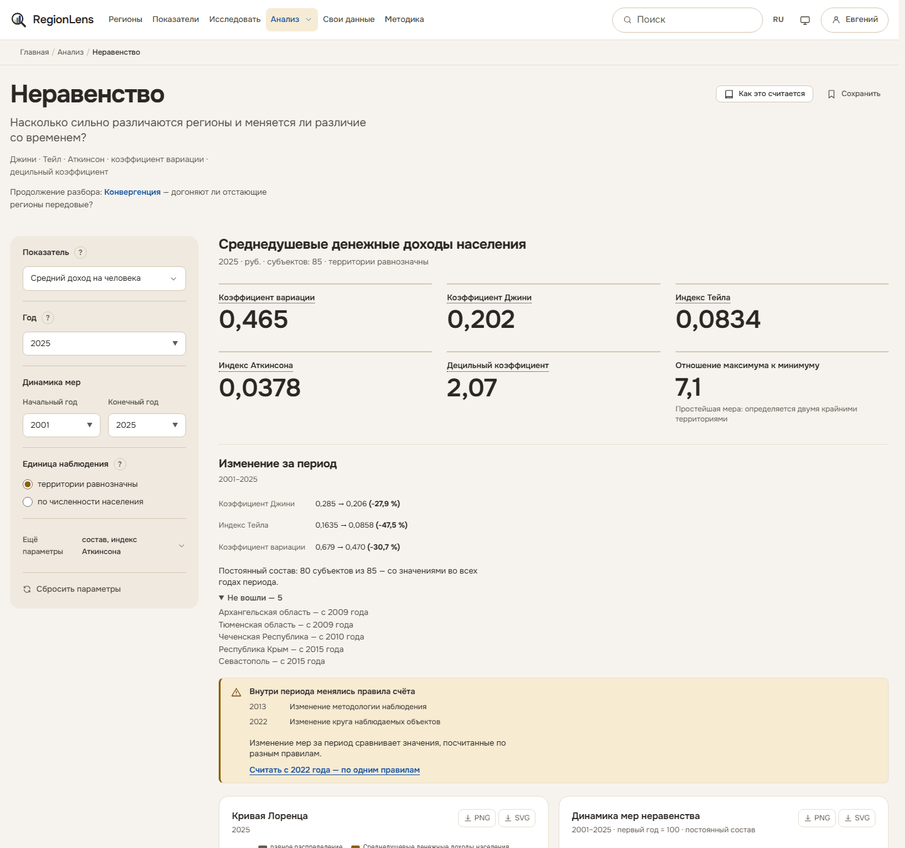
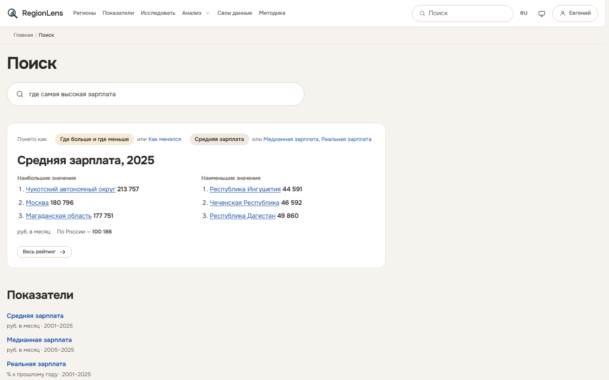
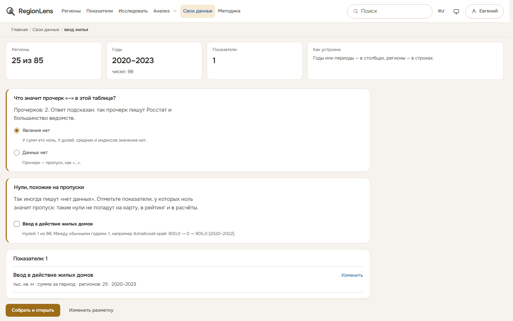
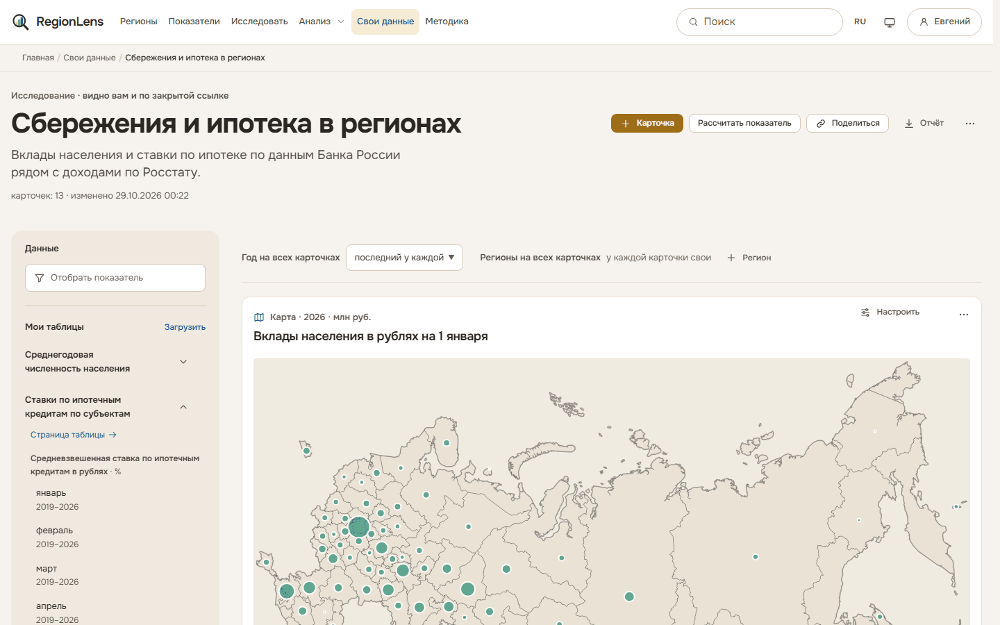
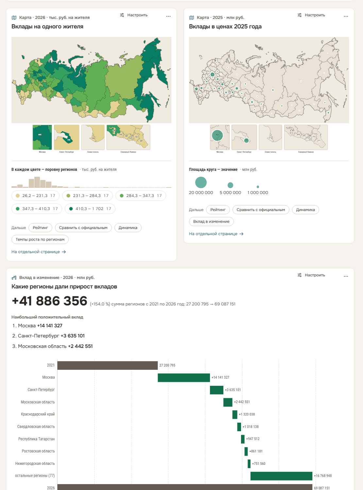
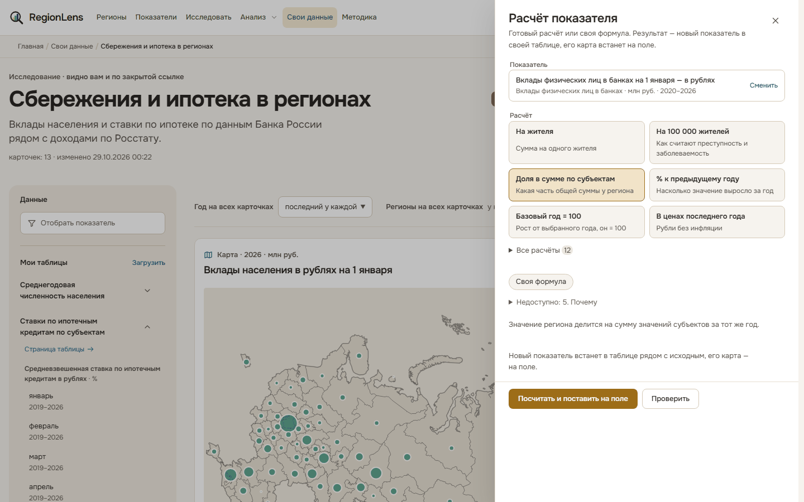

# RegionLens

Веб-приложение для анализа и визуализации социально-экономических показателей регионов
Российской Федерации: данные Росстата за 2001–2025 годы, свежие месячные данные ведомств
и свои таблицы пользователя на одной карте.

[](https://github.com/ht2473/RegionLens_v2/actions/workflows/ci.yml)


[](LICENSE)



---

## Что умеет

**Данные.** 1 317 показателей по 85 субъектам: основной набор по темам с короткими
названиями и полный перечень с отбором. 846 разрывов сопоставимости из методических
примечаний источника отмечены прямо на графиках. Пересмотры значений хранятся по выпускам
изданий. Пропуск, скрытое значение и «явления нет» различаются везде, от графика до выгрузки.

**Свежие значения.** Двадцать два ряда продолжаются после последнего года набора
по ежемесячному бюллетеню Росстата и таблице ВРП. Кредиты, ипотека и малый бизнес — по
данным Банка России и реестра МСП ФНС, зарплата, цены и безработица — по месяцам.
Выпуски собираются сами, хранятся в архиве как получены и сверяются с набором за общие годы.

**Паспорт региона.** Главное о регионе: текущее положение по месяцам, сильные и слабые
стороны по основному набору, динамика, похожие регионы и соседи.



**Исследование.** Карта, динамика, рейтинг, распределение и таблица одного выбора.
Способ разбиения — квантили, равные интервалы, естественные границы (Дженкс), стандартные
отклонения; способ изображения — картограмма или картодиаграмма. Любое состояние экрана —
ссылка, сохранённый вид открывается на текущих данных.



**Анализ.** Шесть инструментов: неравенство (Джини, Тейл, Аткинсон, вариация), сближение
регионов (σ- и β-конвергенция), корреляции, пространственная автокорреляция (индекс
Морана, LISA), интегральный индекс, пересмотры статистики. Если внутри периода менялась
методика, инструмент предупреждает и предлагает считать по одним правилам.



**Поиск вопросом.** «Где самая высокая зарплата», «безработица в Татарстане», «как менялась
рождаемость» — поиск понимает вид вопроса и показатель и сразу показывает ответ числами.
Числами отвечает, только если в показателе нашлись все слова вопроса: на «население Китая»
или «плотность населения» поиск покажет ближайшее, а не чужую цифру.



**Выгрузка.** Таблица значений, паспорт региона и рейтинг — в CSV, XLSX и PDF; открытый
интерфейс REST без ключей.

## Свои данные

Своя таблица по регионам — на той же карте, рядом с официальными данными и с теми же
инструментами анализа. Таблицу видит только владелец.

**Какие таблицы подходят.** CSV, TXT, XLSX, XLS, ODS, Parquet, документы Word (DOCX), PDF
с текстом до 100 страниц, архив ZIP; таблицу можно вставить из буфера, в том числе из Word
частями. Файл — до 25 МБ. Подходят длинные таблицы («регион, год, значение»), годы
в столбцах, как в сборниках, периоды в столбцах и несколько показателей за один год.

**Мастер в три шага: «Файл», «Что в таблице», «Проверка».** Форму таблицы, регионы (по
названиям, кодам и сокращениям), годы и периоды, разрезы и единицы сайт узнаёт сам.
Спрашивает только то, чего из таблицы не понять:

- считать ли Архангельскую и Тюменскую области вместе с автономными округами;
- какой год у значений, если его нет ни в таблице, ни в заголовке;
- какая единица, если её нет;
- что значит прочерк «–» в этой таблице;
- какие нули на самом деле пропуски;
- сводить ли месяцы в год и как: сумма, среднее, декабрь;
- что в строках, если регион повторяется.



**Смысл значений.** У каждого показателя — тип величины: сумма за период (поток), сумма
на дату (запас), доля или среднее, изменение к другому периоду. От типа зависит, что
с показателем можно делать. Сумму показывают на карте значками и сравнивают по значению
на жителя: иначе крупный регион всегда впереди. Доли не складываются, из индекса не
считают темп роста. Неподходящий расчёт не прячется: рядом сказано, почему он не годится.

Знаки Росстата читаются по смыслу: «–» — явления нет, «…» и «x» — нет данных, «К» —
скрыто ради конфиденциальности, «0,0» — меньше единицы измерения. Нули-заглушки
(ноль между обычными годами, слишком много нулей, ноль у всех регионов за год) сайт
показывает до сборки и предлагает считать пропусками. Сумму регионов он сверяет
со значением по России, если оно есть в таблице.

**Исследование — поле карточек.** После сборки таблица открывается в исследовании
с картой. Карточки добавляются окном «Добавить карточку»:

- виды: карта, динамика, рейтинг, распределение, таблица;
- ответы числами: сводка, лидеры и отстающие, положение моего региона, темпы роста,
  вклад в изменение, структура, сравнение федеральных округов, графики по регионам,
  неравенство, сближение регионов, пространственная связь, связь с другими показателями
  сайта, своя группа регионов против остальных;
- сравнение двух показателей и сравнение с официальными данными сайта;
- заметки.

У карточки — свой год, свои отмеченные регионы, способ разбиения и изображения.
Порядок меняется перетаскиванием, ширина — в меню карточки.





**Расчёт показателя.** 23 готовых расчёта: на жителя и на 100 000 жителей, в ценах года,
доля в сумме, Россия = 100, отклонение от России и от среднего по округу, базовый год,
изменение между годами, коэффициент локализации, индекс Херфиндаля — Хиршмана,
разложение «сдвиг-доля» и другие. Либо своя формула из рядов своих таблиц и рядов сайта
с функциями `ЕСЛИ`, `ВГОДУ`, `РОССИЯ`. До сохранения — предпросмотр картой и
предупреждения о смысле: например, что числитель и знаменатель за разные годы.



**Отчёт и ссылка.** Исследование выгружается в Word с графиками и в Excel с данными
карточек, печатается. Закрытой ссылкой исследование или таблицу показывают без входа:
только чтение, на срок и по желанию с правом скачивать.

**Версии.** Новый файл таблицы становится версией с отчётом о различиях; ответы мастера
переносятся.

**Хранение.** Без входа — до трёх таблиц на сутки; после входа они переходят в учётную
запись: до 20 таблиц и 200 МБ.

**Проверка модуля.** Распознавание проверено на корпусе из 3 200 настоящих таблиц
ведомств; расчёты анализа сверены с независимым расчётом на 85 субъектах; путь от файла
до отчёта пройден сквозными проверками в браузере на компьютере и телефоне.

## Источник данных

«Социально-экономические показатели регионов России» // Росстат; обработка: «Если быть
точным», 2026. URL: <https://tochno.st/datasets/regions_collection>. Лицензия — Creative
Commons BY 4.0.

Версия набора `v20260313`: 1 969 010 строк исходной выгрузки, 1 294 показателя, 2 943 ряда,
85 субъектов, 8 федеральных округов, 19 статистических изданий в 38 выпусках, 2001–2025
годы. После разрешения повторов между выпусками в складе 1 909 384 наблюдения из набора
и 21 805 — из выпусков внешних источников.

Новую версию набора ежедневный сбор источников скачивает и проверяет сборкой рядом
с рабочим складом, а администратор принимает её в панели по отчёту о различиях. Перечень
источников, выпуски и итог сверки — на странице «Источники данных» (`/datasets/sources/`).
Условия каждого источника — в [DATA_LICENSE.md](DATA_LICENSE.md) и на странице «Условия
использования» (`/terms/`).

## Проверка

**Расчёты.** Индексы неравенства, корреляции, сближение, классы карты и нормировка сверены
с независимым расчётом на NumPy и SciPy. Индекс Морана и локальные индексы — с esda (PySAL),
регрессия с обычными и устойчивыми ошибками — со statsmodels, веса CRITIC и энтропии и TOPSIS —
с pymcdm. Расхождение не больше 10⁻⁹, значимые регионы LISA те же. Ответы библиотек заморожены
в `tests/fixtures/reference/` и проверяются при каждом прогоне; сценарий пересборки —
`scripts/reference_libraries.py`.

**Данные.** Склад сверен со сборником Росстата «Регионы России. Социально-экономические
показатели. 2025»: 65 357 значений 126 рядов, у которых таблицу сборника можно определить
по названию. С точностью печати совпало 94,5 %; в случайной выборке из 100 значений — 96
(доверительный интервал 90–98 %). Из 3 627 расхождений 812 — значения новее сборника (выпуски
Росстата 2026 года, например ВРП за 2020–2023 годы), 2 639 — из более ранних изданий: в сборнике
2025 года значения за 2015 и 2020 годы на душу населения и коэффициенты уточнены. Значения
склада, взятые из исходного набора, сверены с его файлом: из 1 763 077 отличаются только
53 поправки.

**Поправки к набору.** 53 значения шести рядов исправлены при сборке склада. Например,
«Улавливание загрязняющих атмосферу веществ» по России за пять лет было занижено примерно
в десять раз, а в «Посевных площадях овощей» за 2024 год строки Северо-Запада были сдвинуты.
Правится только то, что подтверждено независимо от сборника: суммой регионов, соседними годами
или сдвигом строк. В самом сборнике тоже есть опечатки, поэтому значения из него без такого
подтверждения не переносятся. Перечень с причинами — `data/reference/source_corrections.json`.
Такие значения отмечены на сайте и в API, а поправка применяется, только пока в наборе стоит
ошибочное значение: исправит поставщик — она отключится сама.

**Сайт.** Страницы всех 2 966 рядов и 96 территорий, рейтинги и карты всех рядов, пригодных
к сравнению, и инструменты анализа открыты на настоящем складе: около 7 100 загрузок без
единого сбоя. Значения и места 145 рядов совпали в складе, API, CSV и XLSX, у рядов основного
набора — ещё в PDF и на странице рейтинга.

**Поиск.** 342 живые формулировки из Яндекс Вордстата разделены пополам до начала работы,
разметка сделана до прогона. Половина использовалась при доработке, вторая прогнана один раз
в конце: верно 92 %, ответ не на тот вопрос 4 %, без ответа 4 %. Отдельно проверены все
показатели основного набора, все места в падежах и сокращениях, виды ответа, опечатки
и совпадение числа в ответе со складом.

## Технологии

| Слой | Решение |
|---|---|
| Сервер | Python 3.14, Django 6.1, Django REST Framework; uv |
| Хранение | PostgreSQL 18 (приложение), DuckDB (аналитический склад, звёздная схема), Valkey 8 (кэш) |
| Клиент | Шаблоны Django, HTMX 2, ES-модули без сборщика, Apache ECharts 6; картограмма — SVG с сервера |
| Оформление | Собственная система маркеров (`static/css/tokens.css`); Onest, Roboto Condensed, JetBrains Mono |

Назначение каждой библиотеки — комментарием рядом с ней в `pyproject.toml`.

## Быстрый старт

Нужны Python 3.14, [uv](https://docs.astral.sh/uv/) и Docker (для PostgreSQL и Valkey).

```powershell
uv sync
docker compose -f docker/compose.dev.yml up -d
# положите data_regions_collection_102_v20260313.parquet в data/raw/
uv run python main.py --setup
uv run python main.py
```

`main.py --setup` создаёт `.env` со свежим ключом, применяет миграции, загружает
справочник территорий, собирает склад, наполняет тексты и собирает переводы; повторный
запуск доводит подготовку до конца, ничего не ломая. `main.py --check` называет,
чего не хватает окружению, не запуская сервер.

Приложение — <http://127.0.0.1:8000/>. Панель отладки Django включается строкой
`DEBUG_TOOLBAR=True` в `.env`.

## Команды управления

| Команда | Назначение |
|---|---|
| `python manage.py seed_reference` | Загрузка справочника территорий с проверкой целостности (`--check` — только проверка) |
| `python manage.py etl_build --full` | Полная сборка аналитического склада |
| `python manage.py etl_build --marts` | Пересчёт витрин без перезагрузки наблюдений |
| `python manage.py etl_build --check` | Профиль исходного файла без записи |
| `python manage.py seed_content`, `seed_content_en` | Тексты методики и глоссария на двух языках |
| `python manage.py seed_catalog_names` | Английские названия разделов, показателей, разрезов, единиц, изданий и переводы примечаний (`--check` — перечень непереведённого) |
| `python manage.py build_boundaries` | Подготовка границ субъектов для карты (`--input FILE` — из скачанного файла) |
| `python manage.py collect --all` | Сбор выпусков источников: в архив, разбор, пересборка склада; с `--due` и `--all` — ещё и проверка новой версии набора (`--due` — кому пора, `--url`, `--file`, `--reparse`, `--no-build`, `--verify`) |
| `python manage.py visits` | Статистика посещений по журналу Caddy (GoAccess из образа; на стенде — таймер раз в час) |
| `python manage.py prune_personal_data` | Удаление персональных данных по сроку из политики обработки (на стенде — таймер раз в сутки) |
| `python manage.py reset_two_factor ПОЧТА` | Выключить вход с кодом у учётной записи, потерявшей телефон и резервные коды |
| `python manage.py crypto_keys` | Новые ключи: для секретов в базе (`--field`) и для резервных копий (`--backup ФАЙЛ`) |
| `python manage.py reencrypt_secrets` | Перешифровать ключи кодов входа текущим ключом после смены (`--dry-run` — только посчитать) |
| `python manage.py record_backup` | Отметка о снятой резервной копии для панели (вызывает `scripts/backup.sh`) |
| `python manage.py backup_seal КАТАЛОГ` | Зашифровать файлы резервной копии и подписать опись |
| `python manage.py backup_verify ОПИСЬ` | Проверить подпись описи и суммы файлов копии, ничего не расшифровывая |
| `python manage.py backup_open ОПИСЬ` | Проверить и расшифровать копию для восстановления (закрытый ключ приносит администратор) |
| `python manage.py userdata_build ВЕРСИЯ extract\|build` | Разбор большой таблицы своих данных отдельным процессом (запускается со страницы мастера) |
| `python manage.py userdata_summarize ВЕРСИЯ` | Сводка большой таблицы своих данных отдельным процессом |
| `python manage.py userdata_worker` | Служба разборов своих данных: выполняет заявки сайта из очереди (на стенде — контейнер `userdata-worker`) |
| `python manage.py userdata_guest_dirs` | Каталоги таблиц без учётной записи — для исключения из резервной копии |
| `python scripts/userdata_corpus.py check\|files\|tables\|build` | Замер распознавания и пути до карты на корпусе настоящих файлов (корпус — вне репозитория) |
| `python scripts/i18n_tools.py extract --locale en` | Обновление каталога перевода интерфейса |
| `python scripts/i18n_tools.py compile` | Сборка двоичного каталога перевода |

Новый выпуск набора загружается и из панели управления («Загрузка данных»): файл
проверяется сборкой рядом с рабочим складом и отчётом о различиях, а после решения
администратора склад собирается из него отдельным процессом (`etl_build --run`); ход
сборки виден на карточке запуска. Одновременно идёт не больше одной сборки.

Сборка склада требует исключительного доступа к файлу DuckDB. В Windows запущенный
сервер разработки держит файл открытым, и сборка завершится сообщением «файл занят
другим процессом» — остановите сервер на время сборки. На Linux новый склад подменяет
прежний и при работающем сервере.

## Доступ

Гостю открыто всё публичное: данные, анализ, поиск, методика, выгрузка документов
(`/documents/`) и интерфейс REST (`/api/v1/`, описание — `/api/docs/`, предел —
1 000 обращений в час с адреса), «Мой регион» — в cookie. Пользователю — личный
кабинет: обзор (мой регион, новое по сохранённому, последние виды), «Сохранённое»
(регионы и показатели с пометками, виды экрана), свои обращения с ответами, профиль,
безопасность (смена пароля и почты, выход на других устройствах, вход с одноразовым
кодом) и персональные данные (выгрузка JSON, удаление учётной записи). Свои таблицы
(`/ru/own-data/`) загружает и гость. Панель управления `/manage/` открыта по ролям:
«Администратор» — целиком (состояние служб, пользователи и роли, загрузка данных
и замечания проверок, источники, обращения, тексты методики и глоссария, посещения),
«Редактор содержимого» — тексты, обращения и посещения; с любой ролью панели вход требует
одноразового кода. Об ошибке 500 администратор узнаёт письмом (`DJANGO_ADMINS`, одна
и та же ошибка — не чаще раза в час), как и о неразобранном выпуске источника,
недоступном источнике и неудачной сборке склада по таймеру.

## Структура проекта

```
regionlens_v2/
├── apps/
│   ├── core/          общие части, служебные страницы, главная
│   ├── accounts/      учётные записи, роли через права, вход с кодом, кабинет
│   ├── catalog/       справочники, паспорт региона, страница показателя
│   ├── warehouse/     ETL-конвейер и запросы к аналитическому складу
│   ├── surface/       рабочая поверхность: пять представлений одного выбора
│   ├── maps/          картограмма: способы разбиения, границы, плиточная карта
│   ├── rankings/      рейтинги субъектов и движение позиций
│   ├── compare/       динамика и сопоставление территорий
│   ├── analytics/     аналитическое ядро и инструменты анализа
│   ├── search/        поиск вопросом: разбор вопроса и ответ числами
│   ├── workspace/     «Сохранённое»: регионы, показатели и виды экрана
│   ├── exports/       выгрузка документов в CSV, XLSX и PDF
│   ├── api/           программный интерфейс REST и его описание
│   ├── content/       методика и глоссарий
│   ├── feedback/      обращения пользователей
│   ├── sources/       сбор выпусков Росстата, Банка России и ФНС: архив, разбор, журнал
│   ├── userdata/      свои данные: приём таблицы, распознавание, смысл значений,
│   │                  сборка, исследование, расчёты, отчёт
│   └── dashboard/     панель управления
├── config/            настройки и маршруты
├── data/
│   ├── raw/           исходный набор данных
│   ├── reference/     справочники: территории, основной набор, статусы рядов, связи
│   │                  с источниками, переводы, сертификаты НУЦ
│   ├── examples/      примеры таблиц ведомств для «Своих данных»
│   ├── uploads/       наборы, загруженные из панели
│   ├── archive/       архив полученных выпусков источников с описью
│   ├── sources/       разобранные выпуски
│   ├── visits/        история посещений и отчёт GoAccess
│   ├── userdata/      таблицы пользователей: исходные файлы и файлы DuckDB наборов
│   └── warehouse/     собранный склад DuckDB
│                      (uploads, archive, sources, visits, userdata и warehouse
│                      в репозитории не хранятся)
├── deploy/systemd/    таймеры хоста: резервная копия, сбор выпусков, статистика посещений
├── docker/            образ приложения, Caddy и описания служб
├── docs/              архитектура, модель данных, интерфейс REST, развёртывание, снимки экрана
├── locale/en/         английский каталог интерфейса (русский — язык исходников)
├── scripts/           выкладка образом по SSH, compose стенда, резервные копии, перевод,
│                      сборка библиотек
├── static/            стили, сценарии, шрифты, библиотеки, границы субъектов
├── templates/         базовые шаблоны
└── tests/             модульные, интеграционные, сквозные проверки и проверки безопасности
```

## Разработка

```powershell
uv run ruff check . ; uv run ruff format --check .   # линтер и форматирование
uv run mypy apps config                              # статическая типизация
uv run pytest -m "not slow and not e2e"              # быстрый прогон
uv run pytest                                        # всё, кроме сквозных
uv run pytest -m e2e                                 # сквозные браузерные сценарии
uv run playwright install chromium                   # браузер для сквозных
```

Те же операции собраны в `Makefile` (`make help`); CI выполняет те же команды.
Изменения по версиям — в [CHANGELOG.md](CHANGELOG.md).

## Документация

| Документ | Содержание |
|---|---|
| `docs/ARCHITECTURE.md` | Устройство системы: контейнеры, компоненты, ключевые процессы |
| `docs/DATA_MODEL.md` | Модель данных, схема склада, соответствие хранилищ |
| `docs/API.md` | Программный интерфейс |
| `docs/DEPLOYMENT.md` | Развёртывание, выкладка образом по SSH, таймеры, резервные копии в S3, наблюдение |

## Лицензия

Исходный код — MIT ([LICENSE](LICENSE)). Данные — на условиях их источников
([DATA_LICENSE.md](DATA_LICENSE.md)): набор Росстата и «Если быть точным» — Creative
Commons BY 4.0 с обязательным указанием авторства; данные Банка России и реестра МСП
ФНС — открытые сведения, со ссылкой на источник.

## Автор

Кузьмин Евгений Олегович, студенческий билет ГМФИТД0401/25-вос.
Тема магистерской диссертации: «Веб-приложение для анализа и визуализации
социально-экономических показателей регионов РФ».
