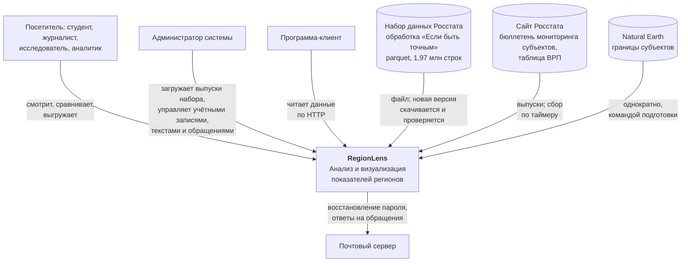
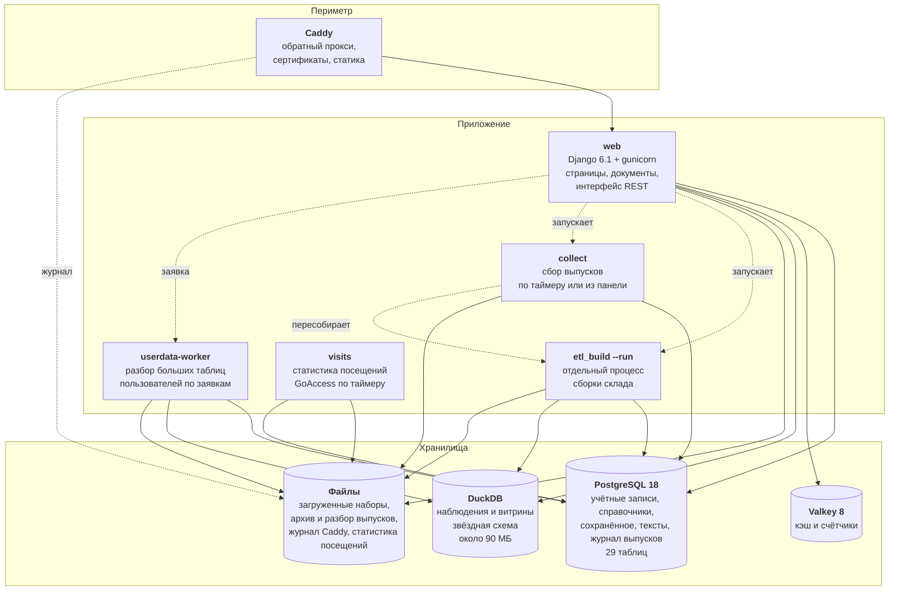
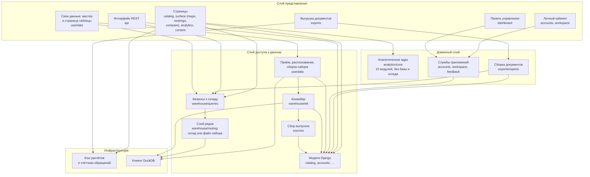
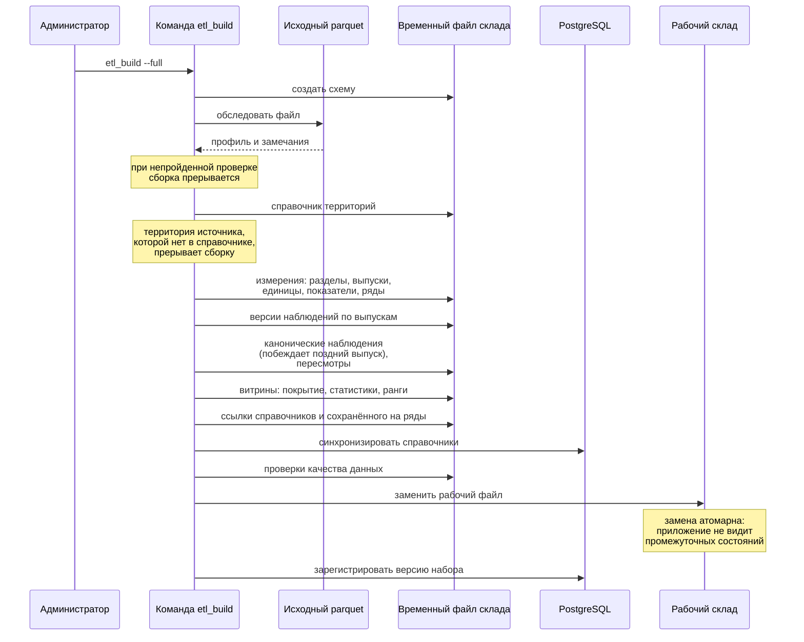
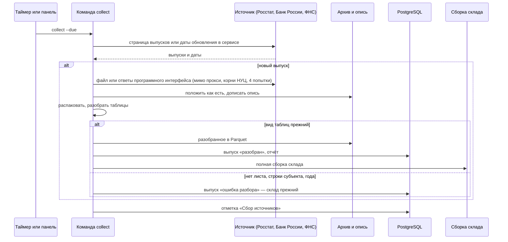
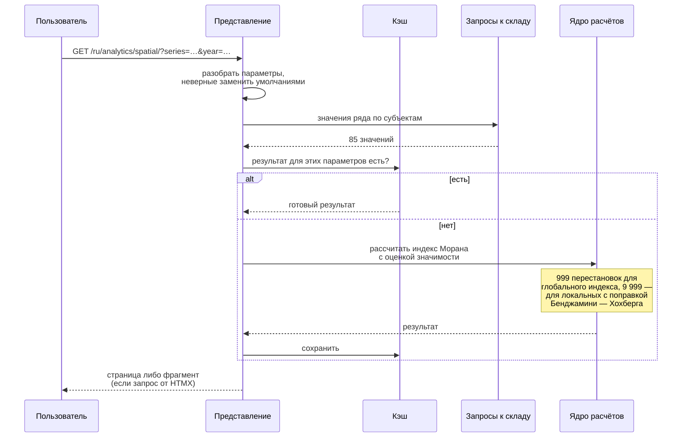
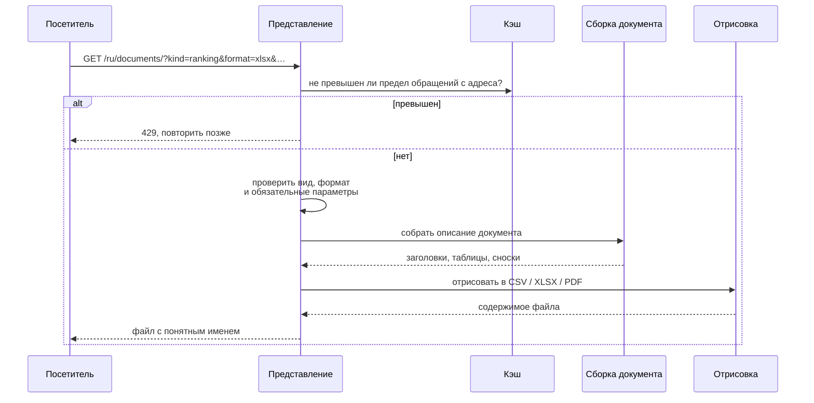
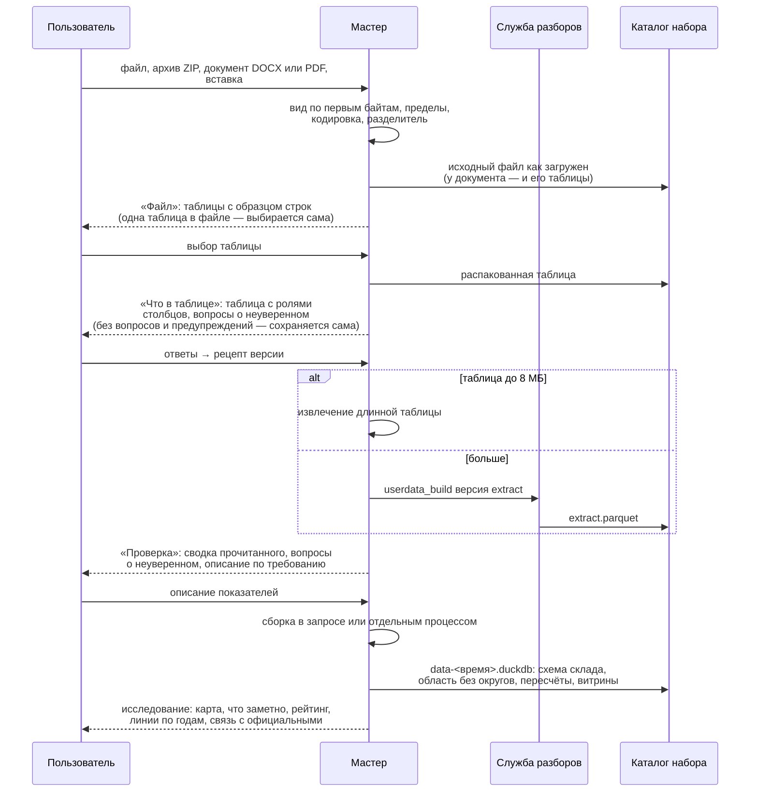

# Архитектура RegionLens

Устройство системы на четырёх уровнях детализации (по модели C4).

---

## 1. Контекст

Во время работы страниц система не обращается к внешним службам, кроме почтового узла.
Исходный набор — файл, границы субъектов готовятся однократно, клиентские библиотеки
и шрифты размещены на собственном домене. К сайту Росстата обращается только сборщик
выпусков (`collect`) — отдельным процессом по таймеру; без сети сайт работает
на последних собранных выпусках.

---

## 2. Контейнеры

Служб пять: прокси, приложение, служба разборов таблиц пользователей, PostgreSQL
и Valkey. Документ по запросу собирается
сразу — это доли секунды; письма тоже уходят сразу, с ограниченным ожиданием почтового
узла. Сборку склада из набора, загруженного в панели (до гигабайта памяти
и исключительный доступ к файлу), приложение запускает отдельным процессом команды
`etl_build --run` и не ждёт её; одновременно идёт одна сборка. Сбор выпусков
(`collect --due`, раз в день), статистику посещений (`visits`, раз в час) и удаление
персональных данных по сроку (`prune_personal_data`, раз в день) запускают таймеры хоста
в контейнере приложения.

Склад собирается в новый файл и подменяет рабочий. Веб-процессы узнают о подмене
по отпечатку файла (время изменения и размер): соединение с прежним файлом открывается
заново, а ключи кэша, зависящие от склада, несут отпечаток и после пересборки перестают
находиться — сбрасывать кэш не нужно. Тем же отпечатком помечены выборки склада,
кэшируемые до пересборки (`by_generation`), и адрес перечня рядов для списков выбора,
который браузер хранит год.

### Два хранилища

| Свойство | Оперативные данные (PostgreSQL) | Аналитические данные (DuckDB) |
|---|---|---|
| Объём | тысячи записей | 2 млн наблюдений |
| Обращения | точечные, по ключу | агрегирование по миллионам строк |
| Запись | постоянная, от пользователей | однократная, при сборке |
| Требования | целостность, транзакции, права | скорость агрегирования |

Склад — файл без отдельной службы; транзакции, миграции и права доступа — за PostgreSQL.

---

## 3. Компоненты

### Правила зависимостей

1. **Аналитическое ядро (`apps/analytics/core/`) не обращается ни к базе данных, ни
   к складу, ни к кэшу.** Из Django оно берёт только перевод подписей
   (`django.utils.translation`). Ядро принимает списки чисел и возвращает числа, поэтому
   формулы проверяются модульными испытаниями против эталонных значений из литературы
   и ответов признанных библиотек (`tests/fixtures/reference/`, сами библиотеки в зависимости
   не входят), без запросов и подготовки данных, а обратиться к базе внутри цикла из ядра
   невозможно.
   Выборку данных и кэш расчётов берут на себя представления (`apps/analytics/views/`,
   `apps/analytics/selectors.py`).

2. **Представления не обращаются к складу напрямую.** Все обращения к DuckDB собраны
   в `apps/warehouse/queries/`, и изменение схемы склада имеет ограниченную область
   влияния.

3. **В склад пишет только конвейер.** Веб-процесс открывает склад только на чтение
   (`DUCKDB_READ_ONLY`, по умолчанию включено), что исключает повреждение файла
   при одновременном обращении. Запрос сверх `DUCKDB_MEMORY_LIMIT` DuckDB выгружает
   на диск — у каждого процесса свой каталог `regionlens.duckdb.tmp/<номер процесса>`:
   в общем каталоге файлы процессов совпадают по имени, и одновременная выгрузка
   роняет процессы.

4. **Расчёт живёт в ядре, а не в представлении.** Похожие регионы в паспорте
   субъекта — расстояние в стандартизованной матрице ключевых показателей
   (`apps/analytics/similar.py` поверх `apps/analytics/core/similarity.py`). Сигма-
   и бета-конвергенция по ряду склада — отрезок, постоянный состав, проверка без Москвы
   с областью и без Северного Кавказа — в `apps/analytics/sigma_beta.py`: ими пользуются
   инструмент и карточка исследования, и выводы не расходятся.

5. **Уровень ответа строится на основном наборе.** Паспорт региона, главная, каталог
   по темам и первая группа списка выбора читают один файл
   (`data/reference/featured_series.json`), а выводы словами — «лучше, чем
   в большинстве регионов», «на 15 % ниже, чем по России», «рост на 10 % за 5 лет» —
   собирает один модуль (`apps/catalog/passport.py`) для страницы и для документа.
   Выводы строятся на сервере по правилам из данных.

6. **Ряды своих данных идут через тот же слой запросов.** Ключ ряда таблицы
   пользователя — `u:<код набора>:<код ряда>`; декораторы маршрута
   (`apps/warehouse/routing.py`) направляют выборку с таким ключом в файл DuckDB набора,
   перечни ключей делят по источникам и сливают ответы. Источник выбирается переменной
   контекста, поэтому `fetch_dicts` и все выборки холста не меняются. Доступ проверяется
   до кэша: недоступный набор слой считает несуществующим и отправляет выборку в склад,
   где такого ряда нет, — даже если представление забыло проверку. Кто спрашивает,
   слою сообщает `UserDataScopeMiddleware`. Соединение с файлом набора — только чтение,
   без доступа к другим файлам и сети, с запертыми настройками, 128 МБ и один поток.

---

## 4. Ключевые процессы

### 4.1 Сборка аналитического склада

Сборка идёт минуты, и всё это время приложение отвечает на прежних данных: новый
склад собирается во временный файл и заменяет рабочий одной операцией. Неудачная
сборка не оставляет приложение с наполовину заполненным складом. После замены процесс
сборки прогревает кэш.

Новая версия набора сначала проходит проверку (`Pipeline.check_candidate`): те же этапы
до сверки ссылок включительно собирают склад во временный файл, затем он сравнивается
с рабочим (`apps/warehouse/etl/compare.py`) — ряды новые, исчезнувшие и переименованные,
изменённые значения, единицы, связи с выпусками источников, новые методические
примечания. Справочники PostgreSQL и рабочий склад не меняются, временный файл удаляется,
отчёт остаётся в журнале запуска. Рабочий склад собирается из этой версии обычной
сборкой, когда администратор её примет.

Ключи рядов, на которые ссылаются справочники проекта (основной набор, связи с выпусками
источников, статусы публикации, численность для рядов на жителя) и сохранённое
пользователями, сверяются с собранным складом (`apps/warehouse/etl/integrity.py`).
Пропавшие ряды сборку не прерывают: они записываются в журнал запуска, видны в его
карточке в панели, а о рядах из справочников проекта администратор получает письмо.

**Разметка разрывов** (`apps/warehouse/etl/classify.py`, при синхронизации справочников).
Примечание источника разбирается по частям: у каждой части — вид изменения (методика,
классификатор, состав территории, круг наблюдаемых объектов, база цен) и год, с которого
ряд несопоставим. «С 2017 года» даёт отметку на 2017 год; «до 2020 г. включительно»
и «с 2000 по 2020 г.» — на 2021-й; «за 2011–2021 гг. без учёта итогов переписи» —
на 2022-й. В перечне «2000–2018 гг. — …; 2019, 2020 гг. — …» отметка ставится на начало
каждого следующего периода, у диапазона по новому классификатору («за 2013–2018 гг.
в соответствии с ОКВЭД2») — на его начало. Пересчёт по итогам переписи и срок документа
(«госпрограмма на 2012–2020 годы») разрыва не ставят. Смена состава территорий
ставится только по части примечания, которая прямо говорит о территориях. Перемена
в составе одного субъекта — присоединение автономного округа к краю или области,
граница Москвы и Московской области, «до 2007 г. — включая данные по г. Санкт-Петербургу»
(`_SUBJECT_CHANGES`) — даёт отметку только ему (`SeriesBreak.territory`). Отметки рядов
ВРП ставятся по сноскам таблицы ВРП (`mart_source_note`); примечания сборника к прежним
значениям этих рядов отметок не дают.

### 4.2 Сбор выпусков внешних источников

Сборка склада заводит каждый выпуск изданием, переводит таблицы в годовые значения
рядов, сверяет их с набором за общие годы и продолжает ряды после последнего года
набора (правила — `docs/DATA_MODEL.md`, раздел 5). Выпуски Банка России и реестра МСП
ФНС дают ряды, которых в наборе нет: сборка заводит их измерения, строит значения
по месяцам (`fact_month`) и годовые значения из месяцев (раздел 5.1). Выпуск Банка
России — ответы программного интерфейса, собранные в ZIP; выпуск ФНС — сведения
реестра на одну дату, поэтому первый сбор берёт всю историю. Архив неизменяем,
разобранное и склад воспроизводятся из него (`collect --reparse`, `etl_build --full`).

### 4.3 Расчёт инструмента анализа

Локальные индексы по умолчанию — с поправкой Бенджамини — Хохберга на 85 сравнений
(`spatial.adjusted`), переключатель «Без поправки» снимает её. Случайные выборки соседей —
одна таблица на все регионы, как в PySAL: 9 999 перестановок считаются за доли секунды.
Наименьший уровень глобального индекса пишется «≤ 0,001» (фильтр `permutation_p`).
Коэффициент вариации без весов — с выборочной σ (n − 1), как в витрине статистик
и в сигма-сближении.

Ключ кэша строится по набору параметров, а не по адресу страницы: одни и те же
параметры в разном порядке дают один ключ. Ключ включает отметку сборки склада,
поэтому пересборка обесценивает сохранённые расчёты сама; срок хранения — час
(`ANALYTICS_CACHE_TTL`).

### 4.4 Выгрузка документа

Документ собирается в ответ на запрос и нигде не хранится: вход не нужен, ждать
нечего, и ссылку из меню «Скачать» можно передать другому человеку — по ней соберётся
тот же документ. Объём ограничен 5 000 строк, частота — 60 документами за десять минут
с одного адреса.

Описание документа отделено от отрисовки: три формата строятся из одного описания,
и новый формат не потребует переписывать сборку данных.

### 4.5 Приём своей таблицы

**Документы** (`userdata/documents.py`). Из Word (DOCX) читаются таблицы тела документа:
объединения раскрываются, как во вставке с разметкой (`gridSpan` и `gridBefore` —
по столбцам, `vMerge` — по строкам, текст — в первой клетке), название — абзац над
таблицей. Таблица под абзацем «Продолжение табл. …» с теми же столбцами и повторённой
целиком шапкой — та же таблица: так «Регионы России» делят субъектов по страницам. Левая
и правая половины широкой таблицы на развороте остаются отдельными таблицами. Из PDF
таблицы читает pdfplumber по линиям таблицы. Таблица, продолженная на следующей странице
с тем же числом столбцов и без своего названия (или под «Продолжение…»), — одна,
повторённая шапка отбрасывается; таблица под другим названием — другая, даже той же
ширины, как и таблица без названия, но со своей, другой шапкой (слайды: «Животноводство»,
затем «Растениеводство»); подпись без значений в начале страницы («в том числе:») — не
шапка, а строка таблицы. Рамки подписей внутри таблицы — её часть. Если линиями расчерчена только шапка
(так верстают сборники Росстата и ведомств), столбцы берутся по линиям шапки, строки — по
строкам текста под ней до пустой полосы; подпись, перенесённая на несколько строк,
склеивается. Подписи шапки, повёрнутые на 90°, читаются словом, а не по знаку. Таблица
Word без вертикальных границ (письма территориальных органов: линейки над таблицей, под
шапкой и под таблицей) pdfplumber не видна; если на странице нет ни одной таблицы по
линиям, она читается по линейкам (`_rule_tables`): Word рисует границу каждой клетки своим
отрезком, стыки отрезков — границы столбцов; шапка — полосы между линейками над телом, тело
— строки текста. Надпись, сквозь слово которой проходит граница столбца, — над несколькими
столбцами: она в первом, остальные пустые, подписи столбцов под ней — следующей строкой
шапки (как объединённые клетки Word). Слово относится к строке и полосе серединой по высоте:
строка шапки, лежащая на линейке, не попадает в тело. Строка — слова, перекрывающиеся по
высоте хотя бы на половину (числа бывают набраны мельче подписи); строка значений над
таблицей названием не считается.
Старый Word (`.doc`) узнаётся по каталогу контейнера в любом месте файла, а не только
в начале, — отказ с советом сохранить DOCX, а не «не читается как таблица Excel». Книга
Excel с вложенным документом Word (в каталоге есть поток книги) — книга.
Скан без текстового слоя, PDF с паролем, больше 100 страниц (`USERDATA_PDF_MAX_PAGES`)
или дольше 30 с (`USERDATA_PDF_SECONDS`) — отказ с советом. Документ читается при загрузке
один раз, его таблицы хранятся рядом с файлом (`.tables.json`); выбор таблицы — как листа
книги, выбранная пишется файлом TSV и дальше идёт путём вставки. «Регионы России» 2025
(25 файлов): вставкой по одной таблице Word — 986 таблиц, из них с 80 и больше узнанными
субъектами 9; файлом — 659 таблиц, таких 320. Форма и роли столбцов у каждой таблицы
файла совпали с проверенной вставкой её первой части.

Слова «год», «период», «месяц», «уровень» в коротком названии столбца чисел отнимают у них роль
значения, только если числа к слову подходят: годы и даты («2023», «2 025»), малые целые
(месяцы 1–12, уровни 1–3). «Количество карт на конец периода, ед.» и «Уровень безработицы, %» —
значения.

**Сопоставление территорий** (`userdata/matching.py`). Подпись сравнивается
со справочником после исправления латинских букв внутри русских слов, слипшихся слов
и сокращений («обл.», «респ.», «АО»); разговорные и английские формы и неоднозначные
написания — из `data/reference/territory_aliases.json`, узнаются коды ISO 3166-2
и ОКАТО. Нечёткое сравнение принимает написание при сходстве не ниже 0,9
(`FUZZY_ACCEPT`) и отрыве от второго кандидата не меньше 0,05 (`FUZZY_MARGIN`);
от 0,75 до 0,9 — кандидаты на выбор. Код ОКАТО или ОКТМО в строке решения не меняет:
в открытых наборах коды Архангельской и Тюменской областей противоречат друг другу,
решает название. Подпись «код и название», как в выгрузке ЕМИСС («14000000000 Белгородская
область», «030 Центральный федеральный округ»), тоже решает название; известный код ОКАТО
(до 12 знаков) выручает только неузнанное название. «Архангельская область» и «Тюменская область» без уточнения — итог
вместе с автономными округами, как у Росстата; если та же область без округов в таблице
есть, итог узнаётся без вопроса, иначе сайт спрашивает. Для сумм область без округов
вычисляется вычитанием округов (в выгрузке пометка «вычислено»), для долей и средних
остаётся пустой. Официальные формы городов («город федерального значения Москва»,
«Город Москва столица Российской Федерации город федерального значения») и строки «Итого»,
«Всего», «Средний уровень по Российской Федерации» узнаются без вопроса; «За пределами РФ»,
нераспределённые значения и федеральная территория «Сириус» — строки вне справочника
с причиной. О номерах столбцов, сносках и «Всего» без названия не спрашивают
(`matching.QUIET_RULES`). Выбор вошедшего запоминается (`TerritoryLabel`).

**Регион в нескольких строках** (`recognize._find_repeats`). Если не меньше половины
регионов (и не меньше пяти) повторяются в строках с разными числами, а столбца разреза
нет, карта взяла бы первое число. Так бывает в двух случаях. В выгрузке ЕМИСС по моногородам
регион стоит в одном столбце, город — в соседнем. Таблица сборника сложена из частей одна
под другой: «зерновые», ниже те же регионы — «подсолнечник». Мастер спрашивает, что
в строках. «Города, районы или другие части регионов» — карта не строится, с объяснением.
«Разные части таблицы» — берётся первая, как раньше. Ответ хранится в рецепте (`repeats`)
и переходит в новую версию файла. Столбец рядом с регионом, где каждое значение встречается
только у одного региона, — города или районы, а не разрез (`_places_are_not_slices`):
иначе карта строилась бы на каждый город. Подсказка о столбце ОКТМО или муниципальных
образований — в тексте вопроса. На корпусе 28.10.2026 повторы у 20–79 % регионов не
встретились ни разу: таблиц с повтором больше половины регионов — 9 из 2721, ниже — 6.

Рецепт версии (выбранная таблица, роли, форма, год, отбор разрезов, ответы о территориях
и вложенных областях, описание показателей с пересчётами, свёртками и сменой методики,
формулы) хранится в PostgreSQL; по нему из исходного файла заново собирается тот же набор. Таблица до 8 МБ разбирается в запросе, большая —
отдельным процессом с опросом хода раз в секунду; одновременно — не больше двух разборов
(`USERDATA_PARALLEL_JOBS`), остальные ждут очереди; предел времени — 120 с. Сбой
разбора, не объяснённый правилами, приходит администратору письмом без содержимого файла.
На стенде (`USERDATA_JOB_WORKER`) процесс запускает не сайт, а служба `userdata-worker`
в своём контейнере с пределом памяти 1,5 ГБ: сайт кладёт заявку в каталог `.jobs` тома
таблиц (`jobs._enqueue`), служба берёт её переименованием и запускает ту же команду
(`manage.py userdata_worker`). Чужая заявка отбрасывается: выполняются только
`userdata_build` и `userdata_summarize` с номером версии. Процесс, убитый без итога (нехватка
памяти, остановка службы), сразу становится неудачей «Разбор прервался», а не через
10 минут. В разработке процесс запускается рядом с сайтом.

---

### 4.6 Ответ поиска на вопрос

Запрос разбирается по правилам (`apps/search/parse.py`), языковой модели нет.

**Места** ищет `places.py` по справочнику территорий, кратким формам, столицам и прозвищам:
сначала длинные написания, среди написаний одной длины — точные совпадения, затем по началу
основы, по остатку без окончания (стеммер режет падежи имён неровно: «Адыгея» → «адыге»,
«Адыгеи» → «адыг») и с одной опечаткой в длинном слове. Страна местом не считается: значение
по России стоит в каждом ответе.

**Вид ответа** определяют шаблоны по полному тексту: «почему», методика, термин, связь, динамика.
Слова этих признаков и слова степени («высокая», «лидеры») в отбор показателя не идут.

**Показатель** ищет BM25 (`index.py`) сначала в основном наборе — по краткому названию,
синонимам, вопросу и полному названию, затем в полном перечне, только среди рядов, пригодных
к сравнению регионов. Опечатка — одна правка основы либо перестановка соседних букв до
стемминга: стеммер режет слово с опечаткой иначе.

**Уверенность.** Показатель принимается, только если в нём нашлись все содержательные слова
запроса, кроме слов о виде ответа («таблица», «росстат», «данные»). Лишнее слово чаще всего
значит, что вопрос о другом: «пособие по безработице» не об уровне безработицы, «население
Китая» не о регионах России. Нет уверенного показателя — нет ответа числами: страница показывает
подборку ближайшего, там хватает половины слов (`results.py`), а запрос попадает в журнал
промахов. Если слова нашлись только в полном названии ряда основного набора, сначала
проверяется полный перечень: там название ряда главное, а в длинном названии слова запроса
могут быть второстепенными.

Формулировки по классам ошибок — `tests/fixtures/search/classes.json`, мерила вопросов —
`benchmark.json` и `blind.json` рядом.

## 5. Слой данных

### 5.1 Оперативное хранилище

36 собственных таблиц в PostgreSQL, включая таблицы связей «многие ко многим»:

| Группа | Таблицы | Назначение |
|---|---|---|
| Справочники | `catalog_territory`, `catalog_indicator`, `catalog_series`, `catalog_unit`, `catalog_section`, `catalog_publication`, `catalog_sourceedition`, `catalog_methodologynote`, `catalog_seriesbreak`, `catalog_territoryadjacency`, `catalog_datasetversion` и две таблицы связей | Навигация, поиск, переводы, отметки разрывов |
| Учётные записи | `accounts_user` и две таблицы связей; роли — `auth_group` с правами `accounts.PanelAccess` | Вход, роли, второй фактор |
| Рабочее пространство | `workspace_savedquery`, `workspace_favorite` | «Сохранённое»: виды экрана, регионы и показатели |
| Содержимое | `content_glossaryterm`, `content_methodologysection`, две таблицы переводов и таблица связей терминов | Тексты на двух языках |
| Обратная связь | `feedback_ticket` | Обращения |
| Служебные | `warehouse_etlrun`, `warehouse_dataqualitycheck`, `core_servicebeat` | Журналы сборки и проверок, отметки служб |
| Источники | `sources_source`, `sources_release` | Внешние источники и журнал их выпусков |
| Свои данные | `userdata_dataset`, `userdata_datasetversion`, `userdata_datasetseries`, `userdata_territorylabel`, `userdata_study`, `userdata_share` | Таблицы пользователей, их версии с рецептом, ряды, запомненные подписи территорий, исследования и закрытые ссылки |

### 5.2 Аналитическое хранилище

Звёздная схема: таблица фактов `fact_observation` и шесть измерений. Дополнительно —
таблица версий `fact_vintage`, помесячный слой `fact_month` и пять витрин: ранги,
статистики распределения
и покрытие рядов нужны почти каждой странице и рассчитываются один раз при сборке;
пересмотры и связи рядов с внешними источниками — разделам анализа и происхождению
значений.
Схема с описанием столбцов — в `docs/DATA_MODEL.md`.

### 5.3 Файлы своих данных

Каталог `USERDATA_DIR/<набор>/<версия>/` (том `userdata`): исходный файл как загружен,
распакованная таблица, `extract.parquet` — длинная таблица по рецепту, и `data-*.duckdb`
— файл набора со схемой склада. Файл набора неизменяем: новая сборка пишет новый файл,
прежний удаляется (занятый другим процессом — очисткой позже). Выборки холста
и витрины (`marts.build_*`) работают на нём без изменений; строки вне справочника —
в отдельной таблице `user_outside`.

Сборка одним проходом SQL кладёт в файл: ряды таблицы; свёртки (сумма по разрезу без
итоговых значений, месяцы в год); пересчёты каждого из них (на жителей и км², в ценах
последнего года по индексу цен региона из склада, Россия = 100, темп к прошлому году,
доля в сумме субъектов); показатели по формулам; ряды с периодами внутри года —
ещё и в помесячный слой `fact_month` под ключом группы показателя. Правила пересчётов:
в ценах последнего года T — только годовые значения в рублях, x(t) × I(t+1) × … × I(T) /
100^(T−t) по индексу потребительских цен региона из склада, при пропуске индекса за год
значения нет; «Россия = 100» делит на значение России из таблицы, у суммы без строки
России — на сумму субъектов за год, в котором есть все субъекты ряда; доля в сумме
субъектов — только у сумм; темп — к тому же периоду прошлого года, только у положительных
значений. Сумма по разрезу не включает итоговых значений («Всего», «Оба пола»); месяцы
сворачиваются в год суммой двенадцати (только у сумм), средним, значением декабря
или итогом «январь–декабрь», год без всех месяцев остаётся пустым. Коды производных рядов —
код исходного ряда с суффиксом, у формулы — постоянный код из рецепта, поэтому новая
сборка и новая версия файла дают те же ключи.

Формула (`userdata/formulas.py`) разбирается своим разборщиком в дерево; ссылки
на ряды — подписи этой таблицы, других таблиц того же владельца и рядов сайта —
заменяются ключами и в рецепте хранятся ключами. Дерево переводится в выражение DuckDB:
сдвиг по годам (`AGO`), место среди субъектов (`RANK`) и знаменатели деления — отдельными
столбцами промежуточных шагов, числа — параметрами, имена столбцов и функций — из перечня
модуля. Считается выражение в соединении в памяти без доступа к файлам и с запертыми
настройками по сетке «территория × год подряд». Таблица, на ряды которой ссылаются формулы
других таблиц, после своей сборки или удаления пересобирает их; круг таблиц при
сохранении формулы не допускается.

Значения рядов таблицы каждой версии лежат в файле набора выпусками — `fact_vintage`
и `dim_edition` с видом `version`, как сборники в складе: сборка новой версии переносит
выпуски прежних из файла версии, на которой она основана (при пересборке — из своего
прежнего файла), добавляет свой и строит витрину пересмотров `mart_revision` теми же
`facts.build_revisions`. Отчёт о различиях — пары «выпуск прежней версии — выпуск этой»
по ряду, субъекту и году; след значения и треугольник версий — те же выборки
`revision_trace` и `revision_triangle`, что у пересмотров склада (они ходят через слой
рядов). Файлы прежних версий читаются через соединения слоя рядов: открытый процессом
файл DuckDB второе соединение с другими настройками не открывает. На диске хранятся
последние `USERDATA_KEEP_VERSIONS` версий; значения удалённых остаются в выпусках новой.

Извлечение после чтения строк ищет коды-маски (`userdata/masks.py`): число из четырёх
и более одинаковых цифр, в десять и более раз больше 95-го процентиля остальных значений
своего показателя, становится пропуском; выбор человека хранится в рецепте. Одно название
у нескольких кодов показателя — разные показатели: код идёт в ключ ряда при чтении,
к названию он добавляется после.

Знаки вместо чисел читаются по условным обозначениям Росстата (`userdata/cells.py`):
прочерк — «явление отсутствует», «К» и пропуск со сноской о конфиденциальности —
«скрыто источником», «0,0» — ноль «меньше единицы измерения». В файл извлечения идут
качество и признаки значения; что значит прочерк для величины, решает сборка по её типу:
у суммы — ноль, у доли и индекса — пустое значение. Источник — Росстат (по файлу, полю
«Источник» или адресу) — вопроса нет; иначе шаг «Проверка» спрашивает, что значит прочерк.
Там же — нули, похожие на пропуски, и замечания о согласованности (`userdata/consistency.py`
— правила, `userdata/review.py` — слова): ноль между двумя обычными годами региона, много
нулей, нулевой год; у сумм — расхождение суммы регионов со строкой России больше 1 %,
скачок разряда между годами, части разреза больше «Всего». Замечания сборку не
останавливают; нули отмеченного показателя сборка делает пропусками. Показатель, у которого
в таблице только строка России, в окне и карточках получает одну причину — регионов нет;
доступна только «Динамика по России». Строки России в таблице нет (вклады Банка России) —
у сумм (поток, запас) «Динамика по России» — сумма регионов в годы, где значения есть не
меньше чем у 80 субъектов, по общему для этих лет составу субъектов (новые субъекты в таблице
не дают роста суммы), с пометкой «Сумма по регионам»; доли и средние не складываются
(`answers._regions_total`).

---

## 6. Интерфейс

Страницы отрисовываются на сервере шаблонами Django. Клиентские сценарии:

* **HTMX** обновляет рабочую область при смене параметров, не перезагружая страницу
  целиком: инструменты пересчитываются часто, и полная перезагрузка сбрасывала бы
  положение прокрутки;
* **средства браузера** держат всплывающие панели: меню разделов шапки, меню учётной
  записи и панели действий («Сохранить», «Ссылка», «Скачать») — атрибут `popover`
  (верхний слой, нажатие мимо и Esc закрывают, открыта одна), в том числе меню языка
  и оформления; командная палитра и выдвижное меню — модальное окно `<dialog>`. Поле
  поиска на странице подсказывает теми же строками, что палитра (`ui/palette.js`),
  а в «Показателях» ещё и отбирает плитки ключами, которые вернул сервер. Собственный
  код только ставит панель под кнопкой и ведёт то, чего браузер не умеет: отборы, применяемые сразу
  (`data-autosubmit`), свёрнутое на телефоне (`data-fold-narrow`);
* **ES-модули и пользовательские элементы** без сборщика: входной модуль
  `static/js/app.js` собирает службы (`lib/`) и поведения на документе (`ui/`),
  а части разметки со своим состоянием — график `<rl-chart>`, выбор ряда
  `<rl-combobox>`, картограмма поверхности `<rl-choropleth>`, ползунок
  `<rl-time-slider>`, живая карта `<rl-live-map>` — пользовательские элементы.
  Модуль элемента загружается, когда элемент появился в документе, в том числе
  во фрагменте HTMX; элемент запускается сам и сам убирает за собой;
* **отрисовкой страниц клиентские сценарии не занимаются**: страницы и фрагменты
  приходят с сервера готовыми.

Диаграммы строит Apache ECharts. Картограмма рисуется на сервере разметкой SVG
(`apps/maps/cartogram.py`) и приходит браузеру готовой: своя проекция, врезки для
субъектов, неразличимых на общей карте, работа без сценариев. Значения у компактной части
страны (габарит меньше трети карты) — карта приближается к ним, не больше чем вчетверо:
контуры записаны с точностью до единицы чертежа; врезка рисуется, только если у её субъекта
есть значение, оставшиеся собираются к середине полосы. Способ изображения — картограмма
(заливка по классам) или картодиаграмма: субъекты ровного цвета, площадь круга — значение (круг в точке подписи
субъекта, у субъекта врезки — во врезке тем же масштабом, что на общей карте; крупные под
мелкими), в легенде — круги круглых значений. Картодиаграмма возможна на географической карте
без сравнения лет и без отрицательных значений; на карточке исследования она по умолчанию
у сумм, картограмма — у относительных величин (`maps/panel.py`, параметр `marks`). Способы
разбиения названы терминами картографии (квантили, равные интервалы, естественные границы
Дженкса, стандартные отклонения), что значит каждый — мелко под ним (`METHOD_NOTES`). Границы
(`static/geo/russia-regions.geojson`) готовит `build_boundaries` из Natural Earth 1:10 млн:
общая граница соседей упрощается один раз и достаётся обоим (иначе упрощённые порознь
границы расходятся, и во врезках видны щели фона), эксклав мельче порога острова
сохраняется, если под ним дыра в соседе (Зеленоград и Москва в Московской области).

### Главная

Уровень «ответа»: полоса «Мой регион» (если он выбран), живая карта одного из главных
показателей, вопросы с готовым ответом, главное о стране и три входа вглубь. Состав
собирается в `apps/core/showcase.py`, полоса региона — в `apps/catalog/brief.py`.

Живая карта — та же серверная картограмма, что и на рабочей поверхности, без подписей
значений. Поверх неё работает элемент `<rl-live-map>` (`static/js/elements/live-map.js`):
карточка под указателем, карточка региона по щелчку (`/regions/<slug>/card/`
во всплывающей панели), перебор годов, поиск своего региона, а на странице
показателя — перечни пяти наибольших и наименьших значений. Элемент ничего
не считает: классы шкалы, места, фразы паспорта и перечни крайних по каждому году
собирает сервер (`live_frames`). Кадр выбранного года встроен в разметку, остальные
приходят одним ответом `/showcase/frames/`, когда читатель тронет ползунок, — около
20 КБ в сжатом виде. Смена показателя заменяет блок карты через HTMX. Части разметки
(`core/partials/_live_*.html`) и стили (`static/css/live-map.css`) общие со страницей
показателя; раскладка у каждой страницы своя.

Без сценариев главная остаётся рабочей: регион ведёт в паспорт, показатель меняется
ссылкой, поиск региона отправляет в перечень регионов, перебор годов скрыт.

### Личный кабинет и доступ

Кабинет — четыре вкладки (`apps/accounts/cabinet.py`): обзор, «Сохранённое», обращения,
«Настройки». Настройки — одна страница с разделами «Профиль», «Вход и безопасность»
и «Персональные данные»; прежние адреса разделов ведут к ним, формы отправляются
на адреса своих действий и с ошибкой возвращают ту же страницу, редкие действия
(смена адреса, новые коды, выключение кода, удаление записи) раскрываются по нажатию.
Обзор — «мой стол»: «Мой регион» той же полосой, что на главной
(`catalog/partials/_region_band.html`: главное и четыре числа «Что сейчас»), «Продолжить» —
плитками последние виды, исследования и свои таблицы, и «Новое по сохранённому»
строкой на регион или показатель и источник (`apps/workspace/updates.py`): выпуски
источников из журнала `sources_release`, уже вошедшие в склад, сопоставляются
с отмеченными рядами и регионами по `fact_vintage` и `fact_month`; новая версия набора,
сменившая прежнюю, называет отмеченные ряды с последним годом набора. Новое — полученное
после прошлого визита; на время сеанса граница не сдвигается, писем об этом нет.

Плитка сохранённого (`apps/workspace/tiles.py`) — одна для вида экрана, региона,
показателя, исследования и своей таблицы: миниатюра, вид, название, показатель
и параметры словами. Миниатюра (`apps/workspace/thumbs.py`) — несколько путей SVG
без подписей: плиточная картограмма квинтилей у карты и показателя, столбики у рейтинга,
точки у распределения, линии у динамики, клетка региона у региона; у инструментов
анализа — значок. Значения берутся теми же выборками склада, что у страниц, из кэша
до пересборки. «Сохранённое» — плитки с отбором по виду; название и пометка правятся
на месте (`static/js/ui/inplace.js`, ответ — JSON), «Убрать» кладёт убранное в сеанс,
«Вернуть» восстанавливает его с прежним адресом и датами. Правки ограничены по частоте.

Меню «Сохранить» — одно на сайте (`apps/workspace/menu.py`, тег ``):
у вида экрана, в паспорте региона и на странице показателя. «В Сохранённое» — одним
нажатием: название вида даётся само (страница и параметры словами, занятое — с номером),
тот же вид второй раз не сохраняется; отметка региона или показателя снимается тем же
пунктом. «В исследование» кладёт вид карточкой, показатель — картой его ряда, регион —
к регионам исследования. С HTMX меню после действия приходит целиком. Версия набора в ссылках для цитирования,
документах и описании набора — текущая из журнала версий (`apps/catalog/versions.py`).

Вход — по почте и паролю под защитой django-axes; при включённом входе с кодом вторым
шагом спрашивается код из приложения (`apps/accounts/totp.py`, RFC 6238; QR-код ключа
рисует сервер кодировщиком reportlab). Неверный код django-axes учитывает как неудачный
вход. Ключ кодов в базе зашифрован AES-256-GCM (`apps/core/secretbox.py`): ключ
шифрования — в настройках сервера, номер ключа — в записи, связанные данные — номер
пользователя, поэтому запись нельзя перенести в другую строку; смена ключа —
`manage.py reencrypt_secrets`. Резервные копии шифруются для ключа получателя X25519
и подписываются Ed25519 (`apps/core/backup_crypto.py`): сервер копию шифрует, но прочитать
не может, восстановление проверяет подпись описи и SHA-256 файлов до расшифровки. Страницы панели проверяют право своего раздела (`PanelPermissionMixin`) и то, что
сеанс прошёл код; меню панели строится по правам. Регистрация, восстановление пароля
и смена почты ограничены счётчиками в Valkey (`apps/core/throttle.py`) по адресу
посетителя и по почте или учётной записи; в регистрации и обращении — поле-ловушка.

«Мой регион» у гостя — cookie, у вошедшего — поле учётной записи. С него начинаются
главная и кабинет, в шапке — значок со ссылкой на паспорт, «Динамика» без выбора
территорий ставит его первым. Кнопка «Это мой регион» — в паспорте и карточке региона.

### Свои данные

Раздел `/ru/own-data/` — шестой пункт меню, рабочий стол (`userdata/desk.py`): зона
загрузки (файл перетаскивают на любое место страницы или выбирают кнопкой — загрузка
начинается сразу; своё поле вместо системного, у того надписи на языке браузера),
«Продолжить» — исследования карточками с миниатюрой (плиточная карта первого ряда за
последний год: плитки легче контуров, карточек бывает два десятка), таблицы строками
с пометкой «черновик» и шагом, где продолжить, «Что можно сделать»; справка о формах
таблиц, примерах ведомств и хранении свёрнута. В первый раз — зона крупнее, «Что
получится» и примеры карточками. Примеры
ведомств — файлы `data/examples/` с описанием в `examples.json` (источник, что пример
показывает, о чём спросит мастер): пример проходит обычный мастер как своя таблица
или скачивается как опубликован. Подпись «Мастер спросит» сверяется с вопросами мастера
проверкой (`test_example_asks_what_its_note_says`): иначе она устаревает незаметно. Мастер — три шага со своими
адресами: «Файл», «Что в таблице», «Проверка»; черновик хранится в базе, обновление
страницы ничего не теряет. Шаг «Файл» с одной таблицей в файле выбирает её сам (вставка
остаётся на шаге: к ней добавляют продолжение), «Что в таблице» без вопросов
и предупреждений сохраняет прочитанное сам — человек сразу видит проверку; к разметке
можно вернуться. У таблицы «показатели в столбцах» без столбца с годом год и период берутся
сами (`recognize.context_stamp`): из шапки соседних столбцов, заголовка над таблицей, шапки
самой таблицы, подписи таблицы в документе, имени листа, имени файла — по порядку («за
I квартал 2023 года», «I полугодие», «на 1 января 2024 г.», «январь–сентябрь», «2023г -
1 квартал», «на 01.07.2026»); база сравнения («в % к январю–сентябрю 2023 г.») периодом
не считается, и когда «В % к» и «июню 2025 г.» стоят в шапке разными строками: строка
шапки сразу после «к», «против», «от» — база (`_column_stamp`), а шапка для года таблицы
читается по столбцам, а не по строкам («В % к | I кварталу 2025 г.» рядом, иначе база сошла
бы за год таблицы — так таблица «Инвестиции в I квартале 2026 года» сборников Росстата
по округам молча собиралась за 2025). Подпись таблицы документа как источник года в мастере
пока не действует: выбранная таблица документа хранится как вставка (`services.choose_table`,
вид CSV), и признак документа теряется — год спрашивается. Год только из имени файла или соседних столбцов при части года в шапке не
подставляется: период не угадать, спрашивается. Имя файла открытых данных («…_data-20220624T1406-structure-…csv»)
года не даёт: даты в нём — версии набора, а цифры кода набора — что угодно («2024»
в «totalnotmarried16th2024th» — возраст 20–24 года). Откуда взят год, видно на обоих шагах,
с полем правки; неисправленный год в рецепт не пишется, исправленный — ответ человека.
Не нашёлся нигде — вопрос, как раньше. Годы в шапке — под названием показателя
(«Безработные | 2026 | 2025» — один показатель за два года), а столбцов чисел без
разобранного года больше, чем таких показателей («Заработная плата в июне 2026 | рублей»,
«Индекс цен в июле 2026») — таблица «показатели в столбцах», а не «годы в столбцах»: столбец
с годом сохраняет свой год, показатель называется по общей надписи (два года — один ряд),
остальные получают год таблицы; иначе столбцы без года терялись молча
(`recognize._mostly_unstamped`). Годы над всей таблицей («2024 | 2025 | 2025 в % к 2024») —
годы в столбцах, как были. Не показатели в этом счёте: столбцы без названия, коды,
справочные, части года без года («I полугодие 2026 г. | Справочно | I квартал» в сборниках
Росстата по округам), с годом не из годов таблицы («Налоговый потенциал … на 2027 год»
рядом с «2023 г.» у Минфина) и столбцы, чьи шапки разнятся только годом («… на 2025 год»,
«… на 2026 год» — ряд одного показателя): такой столбец получил бы год таблицы, а не свой.
Рядов не
больше 500 при разрезах (`MAX_SERIES`, отбор их значений) и 2 000 у таблицы без разрезов
(`MAX_COLUMN_SERIES`: ряды — её столбцы, открытые данные Минкультуры — до 600; сверх
предела — отметить лишние столбцы «пропустить»). Шаг «Показатели» передаёт до 16 полей на
показатель — предел полей запроса (`DATA_UPLOAD_MAX_NUMBER_FIELDS`) под это поднят; список
«Тот же показатель, что…» — только у таблиц до 100 показателей (`views.MERGE_CHOICES_MAX`):
в каждом показателе он перечисляет все остальные, и у 500 показателей страница весила
26 МБ, а выбранное вливание уходит скрытым полем. После первой сборки открывается исследование: то, из панели которого
начата загрузка (карта первого ряда), иначе то, где ряды таблицы уже есть, иначе новое
с первыми карточками по первому ряду (у суммы — по пересчёту на жителей): карта, «что
заметно», рейтинг, линии по годам (лет больше одного), связь с официальными показателями
(субъектов не меньше двадцати) — одной правкой, «Вернуть» убирает их все. Исследование запоминается для самой таблицы
(`lab.remember_study`), а не одно на сеанс: таблица, загруженная не из исследования, не уходит
в последнее, откуда загружали. Куда попадёт карта, сказано до действия — на странице загрузки
и у кнопки сборки, после сборки — сообщением. Описание таблицы сборку не останавливает:
пустое название остаётся прежним, адрес источника без https:// дополняется, текст вместо
адреса уходит в «Источник данных». Свои ряды живут в лаборатории: в перечнях
выбора холста и инструментов сайта их нет, кроме уже открытого (выбранного) ряда. Открытый
на холсте свой ряд подписан «Свои данные · <таблица>» и «видно только вам», ссылка
«О таблице» ведёт на страницу таблицы; запроса к интерфейсу у таких рядов нет.
Шаг «Что в таблице» — сама таблица: первые строки под шапкой, роль столбца — выбором над
ним; вопросы — только о неуверенном (подписи без территории, год, вложенные области, лишние
ряды), отбор разрезов и столбцы периодов широкой таблицы — по требованию. Регион строкой
без чисел с подписями под ним («Всего», «Микро предприятия» у ФТС) — разрез строками:
каждая подпись становится рядом региона. Таблицу по федеральным округам без субъектов
мастер не разбирает и называет причину. Шаг «Проверка» — сводка
прочитанного плитками (регионов из 85, годы, показатели и ряды, как устроена таблица), строки
вне справочника, как прочитаны столбцы (роль и подписи её столбцов); спрашивает о том, что
из таблицы не понять (тип величины без подсказки единицы и названия, пустая единица, месяцы
без годового ряда), остальное описание — в «Изменить». Тип величины — поток (за период),
запас (на дату), сумма без уточнения, относительная или индекс; у сумм — основа сравнения
регионов (жители, площадь, не делить). Что с каким типом можно — одна таблица правил
`userdata/semantics.py` (`RULES`, `verdict`): её читают окно «Добавить карточку», каталог расчётов,
ответы карточек, пересчёты и свёртки сборки и формула. Анализ сумм (разрыв, сближение,
соседство, связь) — через показатель на жителя; запас «на 1 января» делится на численность
на начало года (оценка на конец прошлого года). Название показателя предлагается
коротким (`naming.short_title`): единица в хвосте названия переходит в единицу, годы
и «субъектов Российской Федерации» снимаются. Новые пересчёты добавляются в исследовании
(«Посчитать»), в мастере выбранные можно снять. Деньги узнаются по единице, по названию —
только без единицы или при единице из одного разряда («млн»): «Срок кредитов в рублях»
в месяцах не деньги, и пересчёта в цены года у него нет (`semantics.is_rubles`,
`is_currency`). У денежной суммы в любой валюте пересчёт
по умолчанию — на жителя (и у объёмов: кв. м, тонны), у людей и событий — на 100 000
жителей, у объектов территории — никакой; разряд единицы на жителя
выбирается при сборке по медиане значений (`build.per_person`): «млрд руб.» дают
«тыс. руб. на жителя», а не дробь с шестью нулями. В «Изменить» показателя — ещё масштаб
(значения умножаются или делятся на тысячу, разряд единицы сдвигается: `naming.scaled_unit`;
только у сумм, денег и единиц с разрядом и в пределах разрядов — `Indicator.scalable`,
у месяцев и процентов поля нет),
«тот же показатель, что» — дубль под другим названием вливается в выбранный (его ряды
дополняют ряды выбранного, при совпадении года и региона остаётся значение выбранного;
без цепочек) — и «скрыть» (ряды показателя не собираются, он остаётся в файле). Исходное
название из таблицы видно под полем названия.

Страница таблицы — служебная: смотрят и считают данные в исследовании, карты на ней нет.
Вкладки (вкладка и выбранный ряд — в адресе): «Обзор» — показатели списком и выбранный
(ряды по разрезам и периодам, ряды без значений не выбираются, сведения о ряде, «Открыть
в исследовании», пять видов сайта, «По месяцам», «С чем связан показатель»), показатели
по формулам; ниже — качество: покрытие ведущего ряда картинкой
(`userdata/quality.py`: матрица «субъект × год» — есть значение, скрыто — строка без числа,
прочерк или код-маска, нет строки; субъекты по округам, под картинкой доля клеток, смена
состава и расхождение с итогом страны), пометки (абсолютные величины, мало субъектов,
неполный последний год, вложенные области, строки вне справочника), проверки ведущих рядов,
территории, и владельцу — «Исключить из расчётов»: регионы и годы, которых нет в рядах
(картах, рейтингах, анализе, пересчётах); таблица пересобирается, исключённые значения
лежат в файле сборки отдельно (`user_excluded`) и уходят в выгрузку с пометкой «исключено
из расчётов». Прежний адрес «Проверок» открывает «Обзор». Владельцу — ещё «Версии» (файл,
хранение, версии, удаление) и «Доступ» (закрытые ссылки). Выгрузка очищенной длинной таблицы в CSV и XLSX и исходного
файла — меню «Скачать». Страницы таблиц и шагов — `noindex` и закрыты в `robots.txt`.

Новый показатель заводится в окне «Расчёт показателя» (`calc_views.CalcView` из исследования,
`DatasetCalcView` со страницы таблицы — тогда показатель встаёт в таблицу без поля); адрес
прежней страницы создания ведёт туда же. Правка показателя по формуле
(`userdata/formula_views.py`) — шаблон «A на 1 000 B», «A − B»,
«A / B», «доля A в B» с рядами A и B или своя формула; показатели нажатием или
перетаскиванием встают в A, B или в формулу. Предпросмотр — расчёт по нынешним данным
с малой картой года, в котором больше всего субъектов, и «посчитано для N из 85»;
со сценарием обновляется сам, предпросмотры ограничены по частоте. Формула, открытая
из исследования, после сохранения встаёт в него картой.

Инструменты анализа принимают ряды своих таблиц (из исследования и по адресу):
направленность и тип величины — из описания показателя, смена методики, отмеченная
у показателя, — как разрывы рядов сайта. У таблицы меньше чем с двадцатью субъектами
неравенство, сближение и пространственный анализ не считаются; у суммы неравенство
предлагает ряд на жителя. Проверки ведущих рядов (`userdata/glance.py`) — правилами
по ведущему ряду каждого показателя: сверка суммы субъектов со значением России (вид
величины по данным: сумма совпадает со значением России с расхождением до 2 % или
составляет не меньше 85 % от него при значении России больше любого субъекта — величина
складывается; значение России между значениями субъектов — доля или среднее), смена
состава, пропуски последнего года; на странице таблицы — только
ряды с замечаниями; считаются при открытии страницы и хранятся в кэше расчётов до новой
сборки. «С чем связан показатель»
(`userdata/related.py`) — коэффициент Спирмена с относительными рядами основного набора
(суммы сайта не берутся: связь с ними — размер региона) за последний полный год с поправкой
Бенджамини — Хохберга; год ряда сайта, если он другой, виден у связи; облако точек пары —
в «Корреляциях».

Анализ суммы своей таблицы — через пересчёт на основу (`userdata/via.py`): «Разрыв»,
«Сближение», «Соседство», «Связь с другими показателями» и связь двух рядов считаются по значению
на жителя (у основы «площадь» — на км²). Окно ставит карточку на собранный пересчёт, а нет
его — сначала собирает (одно нажатие); сохранённая карточка на сумме считается по собранному
пересчёту с пометкой, а без него называет причину. Тип пересчёта — по пересчёту, а не по
выбору человека у исходного показателя. Необычные значения (`userdata/unusual.py`): в «Главном
в цифрах» — значения вне 1,5 межквартильного размаха (только у долей, средних и индексов).
Резкие скачки одного региона не ищутся: правило не отличает ошибку ввода от настоящего
события; смену единицы у всех регионов ловит проверка разряда на шаге «Проверка».

Таблица гостя привязана к случайному ключу в сеансе (в базе — его отпечаток), хранится
сутки и при входе переходит в учётную запись. Чужая таблица везде отвечает 404:
по адресу страницы, по ключу ряда на холсте, в документе и сохранённом виде.

**Новая версия таблицы** (`userdata/renew.py`) — черновик рядом с текущей: пока он не собран,
холст, ссылки и исследования работают на текущей. Рецепт прежней версии переносится: та же
таблица файла (по ключу, по имени без чисел или единственная), роли столбцов — по тексту
шапки, ответы о территориях и вложенных, отбор разрезов, выбор кодов-масок, описание
показателей и формулы. Спрашивается только новое — подписи, о которых раньше не спрашивали
(перечень `seen` в рецепте), новая вложенная область, год таблицы «показатели в столбцах»;
без вопросов версия собирается сама и открывает отчёт о различиях. Собранная новая версия
становится текущей; возврат к прежней — сменой текущей версии без пересборки.

**Закрытые ссылки** (`userdata/shares.py`) — на таблицу или исследование: токен из 24 знаков,
в базе — отпечаток SHA-256, срок, отзыв, разрешение скачивать. Адрес `/s/<токен>` без языка
запоминает ссылку в сеансе читателя и ведёт на страницу на его языке; неудачные попытки
с адреса ограничены. Читатель наборов `scope.Scope` знает ссылки сеанса: таблица ссылки
и таблицы владельца исследования, ряды которых в нём есть, читаются слоем рядов, а скачивание
(`routing.exportable`) — только с разрешения. Страницы чтения (таблица, «По месяцам», «С чем
связан», выгрузка) пускают читателя ссылки, шаги мастера, формулы, версии и удаление —
только владельца.

**Лаборатория: исследования** (`userdata/studies.py`, `study_views.py`, `study_cards.py`,
`lab.py`, `answers.py`) — рабочее поле: панель «Данные» (свои таблицы — показатели и ряды,
ряды сайта), общий год и регионы над полем, карточки и заметки. Карточка хранит, что
построить: вид холста (страница и параметры, как сохранённый вид) или ответ на вопрос
о ряде — что заметно (наибольшее и наименьшее значение и их отношение, в скольких регионах
выросло с первого года, у скольких значения нет), лидеры и отстающие, мой регион (место среди регионов и в округе, соседи
по рейтингу), изменение за пять лет, кто вырос сильнее (одна мера изменения на всех:
пункты, проценты или разность), итоги по округам (значение округа из данных, иначе сумма
субъектов у сумм или медиана с размахом), различие регионов (децильный коэффициент, Джини, вариация), сближение регионов
(сигма и бета на отрезке и составе инструмента «Конвергенция», с проверкой без Москвы
с областью и без Северного Кавказа), сходство соседей (глобальный индекс Морана), связи
с основным набором; о двух рядах — связь (Спирмен
и облако точек) и сравнение (линии по годам для общего региона, моего или России — в своих
единицах при общей единице, иначе первый общий год = 100; связь по регионам и регионы,
места которых расходятся сильнее всего). Структура — о частях одного целого: суммы одной
единицы своей таблицы, которые человек отмечает в окне (заранее — разрезы показателя или
показатели с тем же началом названия); столбец региона — 100 %, сверху Россия как сумма
регионов, больше восьми частей — мелкие вместе. «Вклад в изменение» — изменение суммы между
годом исследования и годом не дальше пяти лет назад водопадом: вклады регионов, а у карточки
с частями (из «Дальше» под структурой) — вклады составляющих; у относительной величины
ответа нет, с причиной. Ответы — числами, без текста. Таблица на карточке —
субъекты × последние годы; по выбору владельца клетки раскрашены ступенью общей шкалы
квантилей, нуль и пропуск — без цвета (прежняя «тепловая таблица» открывается так).
«Настроить» карточку (`study_cards.settings_of`, `studies.configure`) — её настройки
в одном окне: как показать, свой год, свои отмеченные регионы, способ изображения, способ
разбиения и подписи карты, цветовая шкала таблицы, ось малых графиков. Показано только то,
что меняет карточку: отмеченные регионы — у видов, «Динамики по России», «Графиков по регионам»
и сравнения двух показателей (`studies.MARKED_QUESTIONS`); года нет у сближения регионов
(весь период) и связи с другими показателями (свой общий год, `studies.YEARLESS_QUESTIONS`);
карточка без таких настроек — без кнопки. Список своих регионов виден только при выбранном
«свои» (`:has()` в `lab.css`): отметки без этого выбора не сохранялись. Источник
под карточкой не пишется: источники поля — одним перечнем под ним (`study_views._sources`),
в картинке карточки — в подписи, в Word — перечнем в конце. Без картинки со страницы
отчёт Word ставит вместо карты таблицу первых и последних регионов, вместо линий —
значения по годам (`report._numbers_instead`).
Под первой карточкой ряда своей таблицы — «Дальше» (`lab.next_steps`): на жителя у суммы,
рейтинг, сравнение с официальным, линии по годам, кто вырос сильнее или почему изменилась
сумма — чего на поле нет; под структурой — почему изменилась сумма частей.
«Группа регионов» — итог группы против остальных (`userdata/groups.py`, `group_views.py`) — своя группа
регионов (страница «Группы регионов», учётной записи или гостя на сутки): итог группы
и остальных регионов по годам — у суммы доля группы в сумме регионов, у относительной
величины среднее, взвешенное по среднегодовой численности, и разница; группу выбирают
в окне. Готовые наборы (`lab.set_blocks`) ставят несколько карточек одной правкой:
профиль показателя, неравенство и сближение, мой регион среди соседей (он и соседи по
матрице соседства становятся общими регионами), два показателя; карточки, которым ряд
не подходит (один год, мало регионов), в набор не входят, после набора страница
перезагружается и новые карточки отмечены.
Панель «Данные» — только данные: свои таблицы с показателями (и ссылкой на страницу
таблицы) и показатели сайта. Нажатие на показатель открывает окно «Добавить карточку»
(`StudyChooseView`, `_study_choose.html`; без сценария — та же страница с открытым окном).
Названия разделов и карточек — принятые термины анализа и BI-программ, а не самодельные
фразы; одна карточка называется одинаково в окне, на поле и в отчёте (`answers.TITLES`).
«Рекомендуемое» — до четырёх пунктов по данным (`lab.advice`: карта, у своей суммы — на
жителя, рейтинг, вклад в изменение или темпы роста и динамика при нескольких годах, связь,
сводка; уже стоящее на поле не рекомендуется). Затем открыта «Визуализация» (виды с теми же
названиями, что в меню сайта, и набор «Профиль показателя»), а «Анализ», «Сравнение» (с рядом
карточки поля или похожим официальным показателем — по названию тем же разбором, что у поиска
вопросом; набор «Два показателя») и «Расчёты» (четыре частых пересчёта и окно расчёта)
свёрнуты с числом пунктов. Пункты «Рекомендуемого» ниже не повторяются: первым экраном —
не больше десяти пунктов. Окно «Расчёт показателя» показывает плитками шесть частых
подходящих расчётов (`operations.POPULAR`, «что получится» — `operations.NOTES`), остальные
подходящие — под «Все расчёты» с поиском, неподходящие — одной строкой с причинами
(`operations.arranged`). Показатель выбирается перечнем внутри окна, устроенным
как панель «Мои таблицы» (`_calc_series.html`; открывается на выбранном в панели, иначе на первом показателе поля — как «+ Карточка», `study_views._default_series`): таблицы раскрываются по одной, раскрыта
таблица выбранного, части показателя — под ним, у каждой единица и годы, поиск — по всем
таблицам; у таблиц с одинаковым названием — когда загружена, и в панели «Мои таблицы» тоже
(`series.twin_notes`). Выпадающий список для этого не годится: он раскрывается по ширине самого длинного
названия во весь экран и смешивает таблицы в одну простыню. Окно пересчитывается при любом изменении формы; поле поиска своё
изменение до формы не доводит (`forms.js`). Условий в `hx-trigger` (`change[…]`), `js:` и
`hx-on` в разметке нет — htmx исполняет их через `Function()`, а политика безопасности
запрещает eval: на стенде условие отбрасывается, на машине разработчика (политика только
пишет в журнал) — исполняется, и окно вело себя по-разному (проверка
`test_template_syntax`). В каталоге расчётов 23 операции
(`operations.OPERATIONS`). Накопленный итог, скользящее среднее, достижение цели, z-оценка,
взвешенное среднее по округу и доля в значении по России убраны 28.10.2026 как редкие или
повторяющие другие. Их можно написать формулой (`НАКОПЛЕННОЕ`, `СКОЛЬЗЯЩЕЕ`, `ВЗВОКРУГ`,
`РОССИЯ`). Наборы «Неравенство и сближение» и «Мой регион среди соседей» убраны тогда же:
их карточки ставятся по одной. Сумма показателей приводит слагаемые к разряду единицы
первого («тыс. руб.» к «млн руб.», `semantics.unit_scale`), разные единицы не складывает.
Индекс Херфиндаля — Хиршмана и индекс структурных сдвигов считают доли частей от итога.
Если отмеченные части расходятся с итогом больше чем на 5 % (медиана по регионам),
предпросмотр предупреждает (`CalcView.coverage_note`).
У пункта — строка «что получится», свой значок и у терминов «?» с определением из глоссария;
недоступное собрано в одну строку «Недоступно сейчас: N. Почему». Карточка встаёт в конец
поля, окно закрывается. Ряд, брошенный на середину карточки, сравнивается с её рядом;
без мыши — «Сравнить с …» в окне и «Сравнить с другим показателем» в меню карточки.
Пересчёт отмечается в описании показателя и пересобирает таблицу; карточка нового ряда
ждёт сборки и обновляется сама. «На жителя» сборка сама не создаёт — его предлагают окно
и «Дальше» (`indicators.suggested_per`). Страница грузит карточки
фрагментами по одной, вид холста строится теми же сборщиками по копии запроса с параметрами
карточки и общим выбором, у карт — свои опознаватели контуров. Перетаскивание карточек
и рядов панели — SortableJS (`static/vendor/sortable.min.js`, только на этой странице),
то же без мыши — «Выше» и «Ниже» в меню карточки; название и заметки правятся на месте,
каждая правка сохраняется сразу, прежние блоки — для «Вернуть»; правки ограничены
по частоте. Мой регион отмечен во всех карточках, регион под указателем подсвечивается
во всех (`lib/highlight.js`). Исследование гостя, как таблица, привязано к ключу сеанса,
хранится сутки и при входе переходит в учётную запись. «В исследование» — в меню
«Сохранить» холста, инструментов, паспорта и страницы показателя. Печать — средствами
браузера по стилям печати.

**Отчёт исследования** (`userdata/report.py`, `StudyReportView`) — файлом, владельцу
и читателю ссылки с разрешением скачивать. Word собирается из той же разметки карточек,
что и поле, — из того, что видно при печати: вид и название, крупное число, списки,
таблицы, пояснение и источник; затем пояснения расчётов своих рядов из каталога
(или формула с названиями рядов) и перечень источников. Документ пишет
`exports/renderers/docx.py` — Office Open XML без сторонних библиотек: A4, свои стили,
таблицы с повторяемой шапкой, картинки PNG, номера страниц. Картинки графиков и карт рисует
страница (`ui/report.js`): графики заново во внеэкранном холсте, карта с легендой, малые
графики сеткой — всё в светлой теме, пока страница не перерисовалась; форма уходит с ними
(`image-<карточка>-<номер>`, только PNG, не больше 4 МБ каждая и 20 МБ вместе). Без
сценария отчёт приходит без картинок. Excel — данные карточек: лист на карточку (номер
и вид), субъект и показатель по строкам, все годы по столбцам. Карточка или заметка
с пометкой «не в отчёте» (меню карточки) не входит ни в файлы, ни в печать. Отчётов —
не больше 20 за десять минут.

**Картинки** (`static/js/lib/image-export.js`): у карты и графиков — PNG и SVG с заголовком,
годом, единицей и строкой источника (`data-image-*` у холста и карточек исследования); карта —
с легендой (у карты значками — круги в масштабе картинки), график в SVG — отдельным
экземпляром ECharts с векторной отрисовкой, без сервера.
Холст программа чтения с экрана не видит: перед каждым `<rl-chart>` — визуально скрытый
абзац «График: заголовок» с описанием по данным — первое и последнее значение линий,
значения столбцов, крайние точки полосы, число точек облака (`RegionChart.describe`,
`describe` в `lib/chart-options.js`).
Малые графики — карточка лаборатории (`userdata/answers.py`, `multiples`): регионы
по федеральным округам с полными названиями, шкала общая или своя у каждой клетки (выбор
хранится в карточке). В рейтинге — «было — стало» за год сравнения и год рейтинга; у облака
точек корреляций подписаны крайние субъекты, при перекосе предлагается логарифмическая шкала.

### Условия, политика и согласие

Три документа: «Условия использования» (`/terms/`), «Политика обработки персональных
данных» (`/privacy/`, ч. 2 ст. 18.1 152-ФЗ) и «Согласие на обработку персональных данных»
(`/consent/`, отдельно от условий по ч. 1 ст. 9). Даты редакций и сроки хранения —
в `apps/core/documents.py`; числа в текстах берутся оттуда и из настроек: условия
и издатели источников — из модулей сбора (`apps/sources/collect.SOURCES`), предел API —
из настроек DRF, срок сеанса и копий — из `SESSION_COOKIE_AGE` и `BACKUP_RETENTION_DAYS`,
срок журнала сервера проверка сверяет с `roll_keep_for` в `docker/Caddyfile`. Упоминание
Sentry появляется, только если он подключён; письма об ошибках идут без значений полей
форм (`FormFreeReporterFilter`).

Регистрация и форма обращения требуют отдельного флажка согласия (без отметки
по умолчанию, ссылка на текст — в новой вкладке); дата и редакция записываются
в `User.consent_at`, `consent_revision` и так же в обращении. У учётной записи, заведённой
без согласия или на прежнюю редакцию, «Мои данные» предлагают дать его заново. Сроки
из политики выполняет команда `prune_personal_data` (таймер хоста раз в сутки).

### Методика, глоссарий и термины

Раздел методики (`apps/content`): что показывает метод — одним предложением, формула,
пример на нынешних данных, два-три ограничения, свёрнутое изложение и литература.
Формула хранится записью MathML (строка — подпись и одна формула) и выводится
браузером без библиотек; разметка проходит белый список элементов и атрибутов
(`content/mathml.py`), потому что её правит и редактор в панели. Пример строится кодом
(`content/examples.py`) по рядам основного набора и региону читателя (без выбранного —
Татарстан): слова — из правил, числа — из склада, поэтому пример не расходится с сайтом
после новой сборки; результат хранится в кэше расчётов до новой сборки, без данных
раздел показывается без примера.

Тексты читателя подчиняются числовым правилам (`content/text_rules.py`): изложение
раздела — до 120 слов (раздел о своих данных — до 80), определение термина — до 40,
средняя длина предложения — до 15 слов, самое длинное — до 25, без «;» и без нескольких
тире в одном предложении. `seed_content` печатает нарушения предупреждениями, проверки
их не допускают. Как устроены действия лаборатории, сказано у самих действий («?»),
а не в методике.

Термин в интерфейсе — тег `` (`content/templatetags/glossary.py`):
подпись-кнопка, по нажатию — краткое определение из глоссария и ссылки в глоссарий
и раздел методики. Карточки терминов собираются один раз на отпечаток содержимого
и язык, отпечаток спрашивается один раз на запрос.

### Паспорт региона

Вводная — три строки с числами (`Passport.lead`): население с местом и изменением,
«в числе лучших» и «в числе худших» — до трёх показателей с местами; строка о полноте —
только когда сведений меньше, чем показателей в наборе. Те же строки — у полосы «Мой
регион», карточки живой карты, ответа поиска и документа паспорта. Доход и зарплата
в фиксированных наборах — у плиток этих рядов. Таблица «Все основные показатели»
приходит заголовками тем: строки темы догружаются при раскрытии (`?rows=theme-<тема>`,
«Развернуть все» — `?rows=all`, `static/js/ui/fold.js`), без сценариев — ссылкой
`?themes=all`. Перечень рядов у динамики догружается, когда поле подходит к окну.

### Страница показателя

Уровень «ответа» о величине (`/indicators/<slug>/?series=<ключ>`): главное словами
(крайние регионы и разница между ними, середина списка, годы и разрывы), плитка
«Россия», живая карта ряда с перечнями крайних, ход страны на фоне коридора квартилей
с отметками разрывов, сведения о ряде и переходы к рабочей поверхности и инструментам
анализа. Выводы собирает `apps/catalog/indicator.py`.

Живая карта открывает любой из 2 952 рядов. Ряд основного набора описан вручную
(короткое название, подпись единицы, направленность); остальные — по источнику
(`describe_series`): название показателя с разрезом, единица из склада, точность
по порядку величины, без оценки «лучше/хуже» — положение называется словами «выше»
и «ниже».

### Рабочая поверхность

Карта, динамика, рейтинг, распределение и таблица — пять представлений одного экрана
«показатель × территории × год». Показатель, территории и год живут отдельно от способа
их показа, и переход к другому представлению не требует набирать выбор заново.

Перечень представлений описан данными: `apps/surface/panels.py` содержит заголовки,
шаблоны, функции сборки и понимаемые параметры каждого представления. Общее состояние
разбирает `apps/surface/state.py`, каркас экрана — `apps/surface/views.py`. Сборка
представлений — в своих приложениях (`apps/maps/panel.py`, `apps/rankings/panel.py`,
`apps/compare/panel.py`); распределение и таблица собираются в
`apps/surface/builders.py`.

У каждого представления свой адрес: `/map/`, `/compare/`, `/rankings/`,
`/distribution/`, `/table/`. Вкладка — обычная ссылка, несущая текущий выбор, поэтому
любое состояние экрана адресуемо. Смена параметра обновляет холст
(`surface/partials/_main.html`), переключение представления заменяет рабочую область
вместе с рейлем, заголовком окна и «хлебными крошками» — у каждого представления свои
параметры построения. Какой из двух ответов собрать, видно по заголовку `HX-Target`.

Рейль — что смотрим: показатель, год, регионы (отмеченные — фишками, перечень —
по требованию, быстрые варианты «мой регион», «соседи», «похожие», «весь округ» —
`apps/surface/picks.py`: ссылка с `pick` дополняет выбор и переводит на обычный адрес). Как показать — в «Настроить вид» над графиком
(`surface/partials/_view.html`): шкала словами с образцом на значениях года, вид карты,
год сравнения, порядок. Форма охватывает рейль, а не всю рабочую область: на холсте стоит
собственная форма сохранения вида, а вложенную форму разбор разметки отбрасывает. Поля
«Настроить вид» приписаны к форме рейля атрибутом `form`, поэтому смена года уносит их
с собой, а смена в панели — весь выбор рейля (`hx-include`). Раскрытая панель остаётся
раскрытой после пересчёта (`data-keep-open`).

У рейтинга (`apps/rankings/panel.py`) каждый блок отвечает на свой вопрос, а период один
на вкладку. «Поднялись / Опустились» — сдвиг мест от года сравнения к году рейтинга
и изменение значения рядом (место падает и при росте значения, если соседи выросли
сильнее); списки считаются в том же порядке мест и в том же округе, что таблица
(`rank_movers`), а равные сдвиги на границе списка называются числом. «Места по годам» —
линия мест за десять лет до года рейтинга прямо в строке списков (зелёный и оранжевый
различимы и при нарушениях цветового зрения, у сдвига — стрелка); график мест по годам
строится только для отмеченных в рейле регионов, остальные на нём — фоном: 85 линий разом
не читаются. «Все места» — таблица с местом,
значением, отношением к России или долей, сдвигом за период и мини-графиком мест за те
же десять лет (свой масштаб строки не уже десяти мест, сдвиг — числом); равные значения
делят место со знаком «=», выбранный округ добавляет место в округе, субъекты без
значения названы под таблицей. Первое место по умолчанию — по смыслу показателя: у
«рост — к худшему» (безработица, бедность) — у наименьшего; явный выбор в адресе
сильнее. Между годом сравнения и годом рейтинга проверяются разрывы сопоставимости.
Выгрузка рейтинга получает те же год сравнения, порядок и округ и лист «Места по годам».
«Таблица» (`apps/surface/builders.py`) — значения всех субъектов и России за десять лет
до года рейла: числа для сверки и выписки, пропуск — прочерком с причиной в подсказке.

Шапка таблицы данных видна при прокрутке (`static/js/ui/scroll.js`). Таблица помещается
по ширине — обёртка не прокручивается (`data-fits`, `overflow: clip`), и шапка закреплена
у страницы под шапкой сайта и строкой пути; их высота замеряется (на телефоне строка пути
бывает в две строки). Широкая и длинная — в рамке высотой в экран (`data-tall`) со своей
прокруткой, шапка и столбец названий закреплены в ней, как в электронной таблице. На печати
рамки нет. Сквозная проверка раскладки (`tests/support/layout.py`) прокручивает каждую
длинную таблицу и сверяет место шапки; там же — выход содержимого за плитку с числом.
Обход действий (`tests/e2e/test_click_feedback.py`) нажимает каждое действие основных
страниц и проверяет, что на экране что-то изменилось и ответ без ошибки: результат ниже края
окна (разбор пары в корреляции) теперь доводится до глаз прокруткой к нему.

Под заголовком графика — строка вывода по правилам (`apps/surface/findings.py`): крайние
регионы и разница между ними, середина распределения, наибольший подъём и падение мест,
изменение линий, направление связи. Пояснения к полям и графикам — по нажатию «?»
(`partials/_hint.html`), постоянной надписью — только сообщение о том, что не так.

#### Связанность представлений

Наведение на строку таблицы отмечает тот же субъект на карте, в перечнях, в списке
выбора и линией на графике; наведение на линию отмечает строку. Связь держится на коде
территории: разметка сообщает о субъекте атрибутом `data-territory`, а линии графика
приносят соответствие «название — код» служебным разделом настроек `territories`,
который клиентский слой снимает до построения. Представления друг о друге не знают.

#### Ссылка, запрос и выгрузка

Экран описывается адресом целиком: число, названное в работе, должно открываться
по ссылке в том же виде, в каком его увидел автор. С любого представления доступны три
действия (`apps/surface/sharing.py`): полный адрес текущего вида, тот же выбор,
обращённый к точке данных программного интерфейса, и документ того вида, который
отвечает представлению (срез по субъектам за год или таблица «субъекты × годы»).

Вместе с адресом запроса показано, чем ответ интерфейса отличается от экрана:
интерфейс отдаёт наблюдения, а разбиение на классы, ранжирование и сводка считаются
над ними. Субъекты без наблюдений в ответе точки данных отсутствуют.

#### Узкий экран

Ниже 1023 пикселей панель выбора уходит под холст порядком в сетке; ниже 767 —
выезжает нижним листом по нажатию на закреплённую полосу вызова. Разметка одна и та же:
лист задан правилами оформления, а не вторым набором органов управления.

Лист включается признаком `data-rail` на корне документа, который ставит
`static/js/ui/sheet.js`, найдя на странице полосу вызова. Без сценариев признака нет,
и панель остаётся обычным блоком под холстом. Полоса вызова приходит вместе с холстом:
её сводка повторяет предмет экрана. Механизмом пользуются рабочая поверхность, каталог
показателей и инструменты анализа.

Ширина холста известна только браузеру, поэтому решения о раскладке принимаются
там: на холсте уже 520 пикселей подписи у концов линий уступают место легенде снизу
(поле под подписи — 186 пикселей, на телефоне это половина ширины), а точки полосы
распределения раскладываются без перекрытий по настоящей ширине холста — высота холста
следует за раскладкой (`lib/chart-options.js`, раздел `swarm`). Данные при этом
не пересчитываются.

#### Гарнитуры

Гарнитур три. Onest набирает интерфейс, связный текст и числа; Roboto Condensed —
плотные места: таблицы данных, подписи и легенду картограммы, подписи осей графиков;
JetBrains Mono — ключи рядов, коды территорий и версии набора, то есть значения,
которые читают по знакам. Узкое начертание нужно из-за длины русских названий
субъектов («Ханты-Мансийский автономный округ — Югра»): оно отделяет подпись,
помещающуюся в столбец, от обрезанной. Свойства начертаний, в том числе покрытие
русского алфавита, закреплены `tests/unit/test_typography.py`.

#### Загрузка

ECharts подключается сборкой из частей: используются несколько построений из сорока,
а географический слой — самая крупная часть полного файла — не нужен. Сборка
одноразовая, её результат лежит готовым файлом (`scripts/echarts/README.md`). График
строится, когда подходит к окну (`IntersectionObserver` с запасом в полэкрана), и
библиотека загружается с первым таким графиком: ради графиков ниже первого экрана её
не грузят; перед печатью строятся все.

Тяжёлые перечни догружаются по требованию. Выбор нескольких показателей — 575 строк
разметки, около четырёхсот килобайт — приходит свёрнутым до отмеченного
и разворачивается ссылкой: со сценариями она заменяет только этот блок, без них
открывает страницу с раскрытым перечнем. Список выбора одного ряда несёт в странице
только выбранный ряд, а полный перечень (121 КБ, сжатым 15 КБ) догружает отдельным
ответом, который браузер хранит год.

Смена страниц — короткое растворение (`@view-transition`).

Все библиотеки размещены на собственном домене (`static/vendor/`): это позволяет
объявить строгую политику содержимого (`SECURE_CSP`) и работать без выхода
в интернет. Встроенных сценариев нет.

---

## 7. Двуязычие

| Слой | Что переводится | Механизм |
|---|---|---|
| Интерфейс | Подписи, кнопки, сообщения | Каталог `locale/en`, функция `gettext`; русский — язык исходников |
| Содержимое | Глоссарий, методика | Переводимые поля моделей (django-parler) |
| Данные | Названия показателей, рядов, единиц и территорий | Столбцы `name_ru` и `name_en` |

Языковая версия различается адресом (`/ru/…`, `/en/…`), а не сеансом: ссылкой
на английскую страницу можно поделиться. Для поисковых систем объявлены связи
`hreflang` и раздельные карты сайта. Каталог перевода собирает
`scripts/i18n_tools.py` — без утилит GNU gettext.

---

## 8. Наблюдаемость

| Средство | Назначение |
|---|---|
| `/healthz` | Живость процесса; по ней контейнер перезапускает зависший экземпляр |
| `/readyz` | Готовность зависимостей: база, справочник территорий, склад |
| Структурированный журнал | На рабочем стенде — построчный JSON (`LOG_FORMAT`) |
| Журнал запусков конвейера | Длительность этапов, профиль источника, замечания качества |
| «Состояние служб» в панели | База, кэш, аналитический склад, последняя сборка, резервная копия, почта, адресаты писем об ошибках, сбор источников, статистика посещений, дисковое пространство — прямые проверки и отметки `ServiceBeat` |
| «Источники» в панели | Журнал выпусков, ошибки разбора, сверка рядов с набором, «Собрать сейчас» |
| Письмо об ошибке 500 | Адресатам из `DJANGO_ADMINS` с трассировкой (`apps.core.logging.ErrorMailHandler`): одна и та же ошибка — вид исключения и место в коде — не чаще раза в час; предел держит процесс, а между процессами — кэш. Отказ почты не обрывает ответ и отмечается в «Состоянии служб». Проверка стенда (`core.W001`) не пропускает запуск, если не заданы ни адресаты, ни Sentry |
| Письма о сборе и сборке | Адресатам из `DJANGO_ADMINS` (`apps.core.alerts`): выпуск не разобран, источник не ответил две проверки подряд, сборка не из панели не удалась. Одно и то же событие — не чаще раза в неделю, пока причина не устранена; не ушедшее письмо уйдёт при следующем таком событии |
| Sentry | Ошибки страниц, без персональных данных; включается `SENTRY_DSN`, по желанию |
| «Посещения» в панели | Статистика по журналу Caddy без счётчиков на страницах (`apps/core/visits.py`): раз в час команда `visits` дочитывает новые строки журнала (смещение хранится по номеру файла и отпечатку его первой строки и переживает деление журнала) и дописывает их в помесячную историю проекта без последней части адреса, строки запроса и служебных меток в адресах; статика и проверки состояния не берутся. GoAccess заново считает по истории отчёт JSON и своей базы не ведёт — его ключ `--anonymize-ip` усекает адреса только в отчёте, а база хранила бы полные. Панель показывает посетителей по дням и месяцам, страницы, переходы, 404, системы и браузеры; выгрузка по дням — CSV |
| Внешняя проверка | Служба наблюдения опрашивает `/healthz` и пишет владельцу, если стенд не отвечает |

---

## 9. Ограничения архитектуры

| Решение | Цена |
|---|---|
| Склад DuckDB в файле | Приложение и склад живут на одной машине; горизонтальное масштабирование веб-процессов потребует копии файла на каждом узле |
| Аналитика в веб-процессе | Расчёты инструментов идут в том же процессе, что и отдача страниц; защита — кэш результатов, предел объёма документа и частоты обращений. Отдельным процессом идёт только сборка склада |
| Отрисовка на сервере | Переключение вкладки требует обращения к серверу; смягчается обновлением через HTMX |
| Решение о новой версии набора | Новую версию набора сбор скачивает и проверяет сам, но рабочий склад заменяется только после решения администратора по отчёту о различиях |
| Разбор по виду таблиц | Смена вида таблицы у источника останавливает разбор выпуска до правки разбора; склад при этом остаётся прежним |
| Кэш в Valkey | Ещё одна служба и до 192 МБ памяти; её недоступность не роняет сайт, но замедляет его |
| Сборка в контейнере приложения | На время сборки приложению нужно до 2,5 ГБ (с разбором таблиц пользователей — до 3,5 ГБ) из 8 ГБ сервера; перезапуск контейнера обрывает сборку (прежний склад остаётся в работе) |
| Письма без повторов | Отказ почтового узла виден в панели, письмо отправляется ещё раз нажатием |
| Поиск по правилам | Вопрос, в котором есть слово вне показателя и вне списков служебных, остаётся без ответа числами; английские опечатки в словах на «-ation» не исправляются: стеммер меняет такие слова сильнее русских |
| Склад хранит значения набора как есть | Ошибки исходного набора попадают на сайт: проверка суммы регионов отмечает их в панели, но значение не меняет; значения за 2015 и 2020 годы взяты из более ранних изданий, чем сборник 2025 года |
| Свои данные в файлах на диске | Набор пользователя — файл DuckDB рядом с приложением; на несколько машин он не делится без общего хранилища. Разбор большой таблицы идёт в контейнере приложения и требует до 768 МБ памяти |
